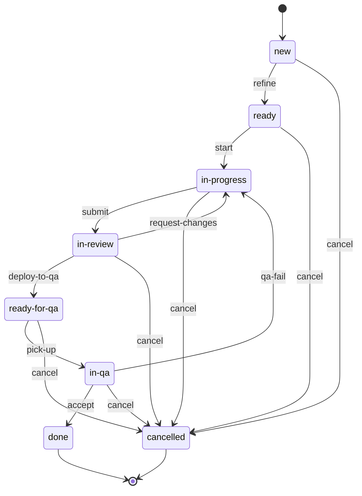
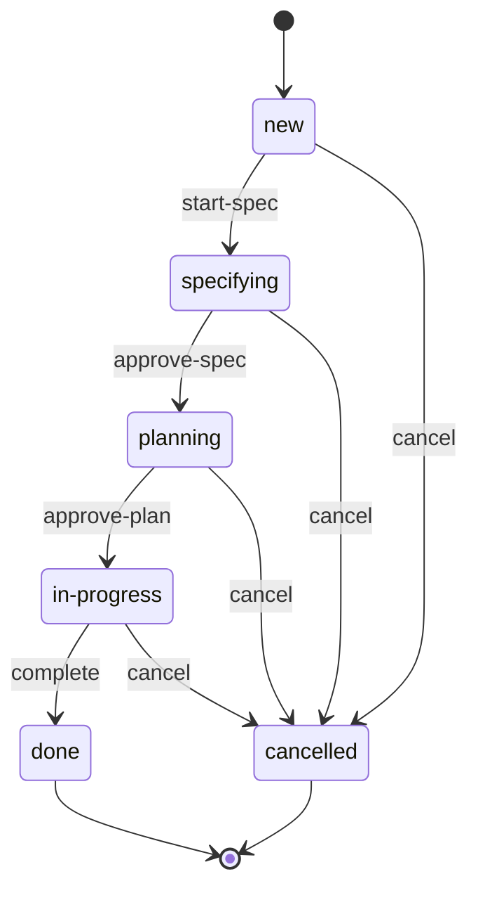
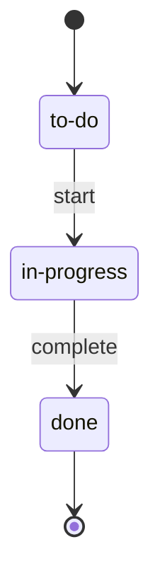

<!-- Generated from contract/*.yaml by scripts/render-docs.mjs. Do not edit by hand: change the YAML, then run `npm run render`. -->

# Quy trình SDLC

Bản đọc của hợp đồng trong `contract/`. Nội dung và lý do của từng quyết định nằm ở [SPEC-sdlc-contract.md](../SPEC-sdlc-contract.md).

## Vai trò

| Role id | Vai trò | Việc chính |
| --- | --- | --- |
| `human` | Bạn: Product Owner, người điều phối, người duyệt duy nhất | Qua 5 cổng duyệt, triage bug, chuyển item sang Done |
| `pm` | Project Manager | Bản tổng hợp mỗi sáng, số liệu tuần cho retro |
| `ba` | Business Analyst | SPEC, user story, acceptance criteria, đề xuất triage bug |
| `ux` | UI/UX designer | Luồng màn hình, wireframe |
| `sa` | Solution Architect | Yêu cầu phi chức năng, plan, ADR, thiết kế DB |
| `fe-dev` | Frontend Developer | Code Next.js theo TDD |
| `be-dev` | Backend Developer | Code NestJS và migration theo TDD |
| `reviewer` | Code Reviewer | Review code, chặn Task trá hình |
| `security` | Security Engineer | Security review, threat model |
| `qa` | Tester/QA Engineer | E2E, regression, báo cáo QA |
| `devops` | DevOps Engineer | Deploy, cắt release, ship, rollback |
| `automation` | CI, webhook, Jira Automation | Chuyển trạng thái theo dữ kiện: CI xanh, merge, deploy xong |

## Giai đoạn và cổng

| Stage id | Giai đoạn | Người làm | Đầu vào | Đầu ra | Điều kiện để qua |
| --- | --- | --- | --- | --- | --- |
| `spec` | Viết SPEC cho Epic | `ba` (chính), `ux`, `sa`; ux viết design khi Epic đụng tới giao diện | Epic ở new | SPEC của Epic (`spec`); Thiết kế màn hình (`design`); PR tài liệu của Epic vào develop, từ nhánh feature/<EPIC-KEY>-spec; bạn đọc diff của nó trước cổng ① | Cổng ① `spec-approval`: Bạn duyệt SPEC của Epic |
| `plan` | Lập plan, tạo Story/Task | `sa` (chính), `ba` | SPEC đã duyệt | Plan (`plan`); Story (`story`); Task (`task`); Plan gồm hợp đồng API cho Story có cả FE và BE, vai trò của từng item và effort của item khó; các Story/Task nằm trên Jira. Plan và ADR vào cùng PR tài liệu, và merge-gate merge PR đó sau cổng ② mà không cần review hay approve trên GitHub | Cổng ② `plan-approval`: Bạn duyệt plan của Epic |
| `build` | Code theo TDD | `fe-dev`, `be-dev` | Item ready | Nhánh, commit, test | Unit và integration test pass ở local; pre-commit pass |
| `ci-gate` | Quality gate tự động | `automation` | PR | Kết quả CI | Mọi check CI xanh |
| `review` | Review code và security | `reviewer`, `security`, `human`; human duyệt sau reviewer và security | PR có CI xanh | Báo cáo review (`review-report`) | Không còn finding Critical/High; Cổng ③ `merge-approval`: Bạn approve PR |
| `merge` | Merge PR | `automation` | PR đã approve | Commit trên nhánh đích | merge-gate pass |
| `qa-verify` | QA trên môi trường kiểm | `qa` | Bản đã deploy lên môi trường QA (mục 2.6) | Báo cáo QA của item (`qa-report`) | Báo cáo PASS; bạn chấp nhận |
| `release-cut` | Cắt release lên Staging, khi bạn yêu cầu | `devops`; Script của ao-step làm thay devops: tính điểm cắt, tạo nhánh release và gắn Fix Version, khi bạn gõ /ao-release <vX.Y.0> <sha> | Điểm cắt trên develop có ít nhất một item Done chưa release; không có nhánh release/* nào đang mở (mục 2.7). Guard: `cut-point-ready`, `no-open-release` | Nhánh release/vX.Y.0 tách từ điểm cắt, Fix Version | Cổng ④ `release-cut-approval`: Bạn duyệt danh sách item của bản |
| `staging-verify` | Full regression, demo, UAT | `qa`, `human` | Bản release trên Staging | Báo cáo regression của bản release (`regression-report`); Release note (`release-notes`) | Regression PASS; không còn Bug Critical/High mở cho bản này |
| `ship` | Lên Production | `devops` | Bản đã qua Staging | Merge vào main, tag vX.Y.Z, merge ngược về develop | Smoke test sau deploy pass; Cổng ⑤ `production-approval`: Bạn duyệt lên Production |
| `hotfix` | Sửa gấp trên Production | `fe-dev`, `be-dev`, `qa`, `devops`; fe-dev hoặc be-dev sửa; gate ⑤ là yêu cầu deploy Production do bạn tạo bằng /ao-ship vX.Y.Z | Bug Critical/High trên Production | Nhánh hotfix/..., tag bản vá | Như ship, rút gọn |

### Cổng duyệt

| Cổng | Gate id | Giai đoạn | Người duyệt | Nội dung |
| --- | --- | --- | --- | --- |
| ① | `spec-approval` | `spec` | `human` | Bạn duyệt SPEC của Epic |
| ② | `plan-approval` | `plan` | `human` | Bạn duyệt plan của Epic |
| ③ | `merge-approval` | `review` | `human` | Bạn approve PR |
| ④ | `release-cut-approval` | `release-cut` | `human` | Bạn duyệt danh sách item của bản |
| ⑤ | `production-approval` | `ship` | `human` | Bạn duyệt lên Production |

## Work item

### Phân cấp

| Mô hình khái niệm | Trong Jira | Work type | Workflow | Ghi chú |
| --- | --- | --- | --- | --- |
| Project | Space |  |  | Mỗi sản phẩm một space |
| Epic (mục tiêu lớn) | Label hoặc Component |  |  | Chỉ để nhóm, không có workflow |
| Feature | Epic | `epic` | `epic` | Có SPEC và plan, kéo dài 1–3 tuần |
| User Story | Story | `story` | `standard` | Đơn vị để QA và Done; tốt nhất làm xong trong 1–2 ngày |
| Task (con của Story) | Sub-task | `sub-task` | `sub-task` | Chỉ dùng khi một Story phải chia cho nhiều agent |
| Task độc lập | Task | `task` | `standard` | Cùng cấp Story. Việc kỹ thuật không trực tiếp mang giá trị cho người dùng |
| Bug | Bug | `bug` | `standard` | Cùng cấp Story. Link tới Story hoặc Epic liên quan |

**Cách chọn loại:** Người dùng cuối có nhìn thấy hoặc kiểm chứng được kết quả không? Có thì là Story, không thì là Task. Hành vi hiện có sai so với yêu cầu đã có thì là Bug.

### Quy ước

- Mỗi Story, Task, Bug có một nhánh và một PR, chứa mọi phần nó cần: FE, BE, migration, test. Item quay lại sau qa-fail thì được sửa trên nhánh và PR mới, vẫn mang mã item (mục 2.6). Tại mỗi thời điểm, một item có tối đa một PR đang mở.
- Story có cả FE và BE được chia thành Sub-task FE và Sub-task BE. Hai agent commit lên cùng nhánh của Story, BE làm trước; PR chỉ được mở khi mọi Sub-task đã xong.
- Story quá lớn thì tách theo chiều dọc thành nhiều Story nhỏ, mỗi Story vẫn đủ FE và BE.
- Phần kỹ thuật của một tính năng thuộc về chính Story đó, không tách thành Task theo lớp (BE, FE). Ngoại lệ duy nhất là phần nền dùng chung cho nhiều Story, như module auth hay schema của cả Epic: phần này là Task độc lập, làm trước, và các Story khai báo phụ thuộc vào nó.
- PR của một Task mà làm đổi giao diện hoặc API công khai thì reviewer yêu cầu đổi Task thành Story.

### Trường dữ liệu

| Trường | Áp dụng | Giá trị | Ai điền |
| --- | --- | --- | --- |
| Found in | `bug` | Development, Staging, Production | Người báo lỗi |
| Affects Version | `bug` | Bản cũ nhất đang có lỗi | ba đề xuất, bạn duyệt |
| Severity | `bug` | Critical: Mất hoặc sai dữ liệu, lỗ hổng bảo mật, hệ thống hoặc luồng thanh toán ngừng; High: Luồng chính hỏng, không có cách né; Medium: Có cách né; Low: Giao diện, chính tả | ba đề xuất, bạn duyệt |
| Fix Version | `story`, `task`, `bug` | Bug: suy ra từ bảng định tuyến (mục 2.6). Story, Task: gắn khi cắt release | automation, devops |
| Agent | `story`, `sub-task`, `task`, `bug` | Project Manager, Business Analyst, UI/UX designer, Solution Architect, Frontend Developer, Backend Developer, Code Reviewer, Security Engineer, Tester/QA Engineer, DevOps Engineer. Vai trò agent đang giữ item. Mọi agent dùng chung một tài khoản Jira, nên assignee không cho biết agent nào; guard wip-available đếm WIP theo trường này | Agent, khi start và pick-up |
| Rework count | `story`, `task`, `bug` | Số lần quay lại in-progress. Không lưu thành trường: là số transition có effect increment-rework trong lịch sử chuyển trạng thái của item | Không ai điền: tự tính từ lịch sử |
| Flagged | `epic`, `story`, `sub-task`, `task`, `bug` | Lý do bị chặn hoặc cần bạn quyết | Bất kỳ ai |
| Resolution | `epic`, `story`, `task`, `bug` | Won't do, Duplicate, Not a bug, Cannot reproduce. Điền khi item chuyển sang cancelled | Bạn |

## Workflow

### `standard`

Áp dụng cho `story`, `task`, `bug`. Bắt đầu ở `new`, kết thúc ở `done`, `cancelled`.

| State | Nghĩa | Cột trên board |
| --- | --- | --- |
| `new` | Mới tạo, chưa đạt DoR | `backlog` |
| `ready` | Đạt DoR, chờ được kéo | `ready` |
| `in-progress` | Đang code và viết test | `in-progress` |
| `in-review` | PR đã mở, CI xanh, đang review | `in-review` |
| `ready-for-qa` | Đã merge và deploy lên môi trường QA | `qa` |
| `in-qa` | QA đang kiểm | `qa` |
| `done` | Đã verify, đạt DoD. Trạng thái kết thúc | `done` |
| `cancelled` | Không làm nữa, có Resolution. Trạng thái kết thúc, ẩn khỏi board |  |

| Transition | Từ → đến | Ai chuyển | Điều kiện | Bằng chứng | Effect |
| --- | --- | --- | --- | --- | --- |
| `refine` | `new` → `ready` | `automation`, `human`: automation chuyển Story/Task thuộc Epic có plan đã duyệt; human chuyển Bug sau triage và Task không thuộc Epic | Item đạt DoR của loại đó (mục 2.5): Story/Task thuộc Epic có plan đã duyệt, Bug đã qua triage | `tracker` |  |
| `start` | `ready` → `in-progress` | `fe-dev`, `be-dev`, `devops` | Agent còn chỗ WIP: tính theo Sub-task nếu Story có Sub-task, nếu không thì theo cả item (mục 2.7); Các item phụ thuộc đã merge vào nhánh gốc; Đã tạo nhánh từ đúng nhánh gốc (mục 2.6), có trên GitHub | `tracker`, `git` |  |
| `submit` | `in-progress` → `in-review` | `automation` | Mọi Sub-task của item đã done; PR vào đúng nhánh gốc đã mở; Mọi check CI của PR xanh | `tracker`, `github-pr`, `ci` |  |
| `request-changes` | `in-review` → `in-progress` | `reviewer`, `security`, `human`, `automation` | Review trên PR yêu cầu sửa, hoặc CI của PR đỏ | `github-pr` | `increment-rework` |
| `deploy-to-qa` | `in-review` → `ready-for-qa` | `automation` | Bạn đã approve PR ở cổng ③ merge-approval; PR đã merge vào nhánh gốc; Deploy lên môi trường QA của item (mục 2.6) thành công | `github-pr`, `deploy` |  |
| `pick-up` | `ready-for-qa` → `in-qa` | `qa` | Không có | Không có |  |
| `qa-fail` | `in-qa` → `in-progress` | `qa` | Báo cáo QA mới nhất của item có kết quả FAIL | `tracker` (`qa-report`) | `increment-rework` |
| `accept` | `in-qa` → `done` | `human` | Báo cáo QA mới nhất của item có kết quả PASS; Item đạt DoD của loại đó (mục 2.5) | `tracker` (`qa-report`), `human` |  |
| `cancel` | `new`, `ready`, `in-progress`, `in-review`, `ready-for-qa`, `in-qa` → `cancelled` | `human` | Item có Resolution: Won't do, Duplicate, Not a bug hoặc Cannot reproduce | `tracker` |  |

### `epic`

Áp dụng cho `epic`. Bắt đầu ở `new`, kết thúc ở `done`, `cancelled`.

| Transition | Từ → đến | Ai chuyển | Điều kiện | Bằng chứng | Effect |
| --- | --- | --- | --- | --- | --- |
| `start-spec` | `new` → `specifying` | `human` | Còn chỗ WIP cho Epic ở specifying hoặc planning (mục 2.7) | `tracker` |  |
| `approve-spec` | `specifying` → `planning` | `human` | Bạn duyệt SPEC của Epic ở cổng ① spec-approval | `human` (`spec`) |  |
| `approve-plan` | `planning` → `in-progress` | `human` | Bạn duyệt plan của Epic ở cổng ② plan-approval; Các Story/Task con theo plan đã được tạo trên Jira | `human` (`plan`), `tracker` | `refine-children` |
| `complete` | `in-progress` → `done` | `human` | Mọi item con đã Done hoặc Cancelled; Mọi item con đã Done nằm trong một bản đã lên Production | `tracker` |  |
| `cancel` | `new`, `specifying`, `planning`, `in-progress` → `cancelled` | `human` | Item có Resolution: Won't do, Duplicate, Not a bug hoặc Cannot reproduce | `tracker` |  |

### `sub-task`

Áp dụng cho `sub-task`. Bắt đầu ở `to-do`, kết thúc ở `done`.

| Transition | Từ → đến | Ai chuyển | Điều kiện | Bằng chứng | Effect |
| --- | --- | --- | --- | --- | --- |
| `start` | `to-do` → `in-progress` | `fe-dev`, `be-dev` | Agent còn chỗ WIP: tính theo Sub-task nếu Story có Sub-task, nếu không thì theo cả item (mục 2.7) | `tracker` |  |
| `complete` | `in-progress` → `done` | `fe-dev`, `be-dev` | Phần việc của Sub-task đã được commit lên nhánh của Story | `git` |  |

## DoR và DoD

### DoR

Điều kiện để item vào `ready`.

| Loại | DoR |
| --- | --- |
| `story` | Có câu user story; Có acceptance criteria dạng Given/When/Then, mỗi tiêu chí kiểm thử được; Thuộc Epic có plan đã duyệt; Đã xác định item phụ thuộc; Vừa cỡ: mỗi Sub-task, hoặc cả Story nếu không có Sub-task, khoảng 5 file code trở xuống, không tính file test; Có hợp đồng API trong plan nếu Story có cả FE và BE; Có thiết kế màn hình nếu đụng tới giao diện |
| `task` | Có mục tiêu và checklist kỹ thuật kiểm tra được; Thuộc Epic có plan đã duyệt, hoặc được bạn duyệt trực tiếp |
| `bug` | Có bước tái hiện, kết quả thực tế và kết quả mong đợi; Đã điền Found in, Affects Version, Severity, Fix Version; Có bằng chứng (log, ảnh) |

### DoD

Điều kiện để item vào `done`. Phần chung cho `story`, `task`, `bug`:

- PR đã merge vào đúng nhánh gốc, mọi check CI xanh
- Không còn finding Critical/High chưa xử lý
- Hành vi mới hoặc thay đổi được phủ bởi unit và integration test viết theo TDD
- Báo cáo QA PASS trên đúng môi trường QA
- Đã cập nhật tài liệu, và ADR nếu có thay đổi kiến trúc
- Bạn đã chấp nhận

Phần riêng của từng loại, cộng thêm phần chung nếu loại đó có trong danh sách trên:

| Loại | DoD |
| --- | --- |
| `epic` | Mọi item con đã Done hoặc Cancelled; Bản chứa các item con đã lên Production |
| `story` | E2E test cho từng acceptance criterion đều pass |
| `task` | Bộ regression pass |
| `bug` | Có test tái hiện lỗi (fail trước khi sửa, pass sau khi sửa), được đưa vào bộ regression |

## Môi trường, nhánh và định tuyến bug

| Môi trường | Nhận code từ | Khi nào deploy | Dữ liệu |
| --- | --- | --- | --- |
| Development | `develop` | Tự động mỗi khi develop có commit mới | Dữ liệu test |
| Staging | `release/*`, `hotfix/*` | Khi nhánh release hoặc hotfix có commit mới | Giống production, đã ẩn danh |
| Production | `main` + tag | Sau cổng ⑤ | Thật |

**Việc mới** (`story`, `task`) tách nhánh từ `develop` và được QA trên `development`.

### Định tuyến bug

Theo vị trí của bản cũ nhất đang có lỗi, và Severity:

| Bản cũ nhất đang có lỗi | Severity | Fix Version | Nhánh gốc | QA trên | Ghi chú |
| --- | --- | --- | --- | --- | --- |
| Production | `critical`, `high` | Bản vá của bản đang chạy trên Production (`patch-of-production`) | `main` | `staging`, `production` | Nhánh hotfix/... tách từ main. QA trên Staging, rồi smoke test trên Production |
| Production | `medium`, `low` | Bản kế tiếp (`next-release`) | `develop` | `development` |  |
| Staging, chưa lên Production | `critical`, `high` | Bản đang ở Staging (`current-release`) | `release/*` | `staging` |  |
| Staging, chưa lên Production | `medium`, `low` | Bản kế tiếp (`next-release`) | `develop` | `development` | Ghi known issue vào release note |
| Chỉ có trên develop | `critical`, `high`, `medium`, `low` | Bản kế tiếp (`next-release`) | `develop` | `development` |  |

- Bug được sửa trên nhánh cũ nhất còn cần bản sửa, rồi merge ngược về các nhánh mới hơn.
- Lỗi Critical/High được chen vào luồng ngay; lỗi Medium/Low vào Product Backlog để bạn xếp thứ tự.
- Nhánh release/* và hotfix/* khi kết thúc đều được merge vào main và merge ngược về develop; hotfix làm lúc đang có nhánh release mở thì được merge thêm vào nhánh release đó.
- Lỗi tìm thấy khi QA một item chưa Done thì không tạo Bug: item quay lại in-progress qua qa-fail, và được sửa trên nhánh mới tách từ nhánh gốc cũ, vẫn mang mã item cũ.

### Đánh số phiên bản

Theo SemVer:

- Mỗi bản release: tăng `minor` (v1.4.0 → v1.5.0)
- Hotfix: tăng `patch` (v1.4.0 → v1.4.1)
- Thay đổi phá vỡ tương thích, do bạn quyết: tăng `major`

## Nhịp làm việc, release, WIP và số liệu

Quy trình chạy theo Kanban: agent kéo item ready kế tiếp khi còn chỗ WIP. Không có sprint, story point hay Daily Scrum.

| Thời điểm | Việc |
| --- | --- |
| Thứ 2 | Bạn sắp lại thứ tự Product Backlog và duyệt các SPEC, plan đang chờ (cổng ① ②) |
| Hằng ngày | pm gửi bản tổng hợp từ Jira và GitHub: việc đang chờ bạn, các item đã Done nhưng chưa release, và item Done đã chờ release lâu nhất |
| Khi bạn quyết định | release-cut lên Staging; full regression, demo và UAT trên Staging; rồi ship (cổng ④ ⑤) |
| Thứ 6 | Retro dựa trên số liệu của tuần |

### Release

- **Release theo quyết định của bạn, không theo lịch cố định.** Bạn cắt release khi thấy đủ giá trị để đưa lên, ví dụ khi mọi Story của một Epic đã Done, hoặc khi khách cần sớm một tính năng. Lúc lên Production cũng do bạn quyết ở cổng ⑤.
- **Điểm cắt.** develop nhận merge liên tục, nên lúc bạn muốn release thường vẫn còn item đã merge nhưng chưa Done. Vì vậy nhánh release tách từ điểm cắt, không từ commit mới nhất của develop. Điểm cắt là commit mới nhất trên lịch sử develop sao cho mọi item có commit tính tới điểm đó đều đã Done, và không item nào trong số đó còn commit nằm sau điểm cắt. Key của Epic không tính: Epic không được release, item con của nó mới được, nên commit tài liệu của Epic đi theo điểm cắt chứa nó. Item Cancelled cũng không tính: Cancelled là trạng thái cuối, nên một item bị hủy sau khi đã merge sẽ chặn điểm cắt mãi. Code của nó đi theo điểm cắt chứa nó mà không nhận Fix Version, và danh sách ở cổng ④ ghi riêng các item đó; code nào không được lên thì revert trên develop trước khi cắt. Item nằm sau điểm cắt vào bản kế tiếp. release-workflow tính điểm cắt và đưa bạn danh sách item để duyệt ở cổng ④.
- **Mỗi lúc chỉ có một nhánh release/* mở.** Muốn cắt bản mới thì bản đang ở Staging phải lên Production xong trước.
- **Fix Version.** Luôn có sẵn một Fix Version chưa phát hành làm "bản kế tiếp", vì Bug Medium/Low được gắn vào đó ngay khi triage (mục 2.6). Khi cắt release, Fix Version này được gán cho các item trong điểm cắt; item nằm sau điểm cắt chuyển sang một Fix Version kế tiếp mới. Mô tả Fix Version ghi mục tiêu của bản để báo khách; mục tiêu là dự báo, không phải cam kết.

### Giới hạn WIP

Giới hạn mặc định, chỉnh được ở retro:

| Chỗ | Giới hạn |
| --- | --- |
| Việc đang làm của mỗi dev agent: Sub-task nếu Story có Sub-task, nếu không thì cả item | 1 |
| Cột In Review (gồm PR đang chờ bạn approve) | 2 |
| Epic ở specifying hoặc planning | 1 |

### Số liệu cho retro

| Số liệu | Cách tính |
| --- | --- |
| Cycle time | Từ lúc vào in-progress tới lúc vào done |
| Thời gian chờ release | Từ lúc item vào done tới lúc bản chứa nó lên Production |
| Throughput | Số item vào done trong tuần |
| Rework | Tổng Rework count, và các item chạm giới hạn 3 |
| Lỗi lọt | Số Bug có Found in là Staging hoặc Production, theo từng bản release |
| Thời gian chờ bạn | Tổng thời gian item nằm chờ một cổng duyệt hoặc mang cờ "Needs you" |
| Usage mỗi item | Cấp 1 ghi tay nếu đo được; Cấp 2 đo tự động |

## Xử lý lỗi

- Rework count chạm `3` thì thêm effect `flag-needs-you`.
- CI fail nghi do test chập chờn được chạy lại tối đa `1` lần.
- Agent dừng sau `2` lần thất bại liên tiếp ở cùng một bước.

| Tình huống | Xử lý |
| --- | --- |
| Review yêu cầu sửa, CI đỏ, QA FAIL | Về in-progress, Rework count tăng 1 |
| Rework count chạm 3 | Gắn cờ "Needs you", agent dừng xử lý item |
| CI fail nghi do test chập chờn | Tự chạy lại tối đa 1 lần. Fail lần nữa thì coi là fail thật, và ghi test đó vào danh sách cần sửa |
| Agent thất bại 2 lần liên tiếp ở cùng một bước | Dừng, gắn cờ "Needs you", kèm log |
| Chạm giới hạn usage | Dừng, ghi tiến độ vào ledger của item, làm tiếp ở phiên sau |
| Deploy lên môi trường QA thất bại | Item giữ nguyên in-review, gắn cờ; devops xử lý |
| Smoke test sau khi lên Production fail | Rollback về bản trước, tạo Bug Critical |

## Artifact và template

| Artifact | Template | Ai tạo | Lưu ở đâu |
| --- | --- | --- | --- |
| SPEC của Epic | `templates/spec.md` | `ba` | Git: `docs/specs/<EPIC-KEY>/spec.md` |
| Thiết kế màn hình | `templates/design.md` | `ux` | Git: `docs/specs/<EPIC-KEY>/design.md`; Git: `docs/specs/<EPIC-KEY>/design/`, ảnh của màn hình kiểu Figma hay Ảnh |
| Plan | `templates/plan.md` | `sa` | Git: `docs/specs/<EPIC-KEY>/plan.md` |
| ADR | `templates/adr.md` | `sa` | Git: `docs/adr/NNNN-<slug>.md` |
| Epic | `templates/epic.md` | `human` | Jira: Mô tả item |
| Story | `templates/story.md` | `ba` | Jira: Mô tả item |
| Task | `templates/task.md` | `ba` | Jira: Mô tả item |
| Bug | `templates/bug.md` | Người báo lỗi | Jira: Mô tả item |
| Mô tả PR (bàn giao từ dev sang reviewer và QA) | `templates/pull-request.md` | `fe-dev`, `be-dev` | GitHub: Mô tả của PR |
| Báo cáo review | `templates/review-report.md` | `reviewer`, `security` | GitHub: Review trên PR |
| Báo cáo QA của item | `templates/qa-report.md` | `qa` | Jira: Comment trên item, kèm link artifact CI (video, trace) |
| Báo cáo regression của bản release | `templates/regression-report.md` | `qa` | Git: `docs/releases/vX.Y.Z.md`, trên nhánh release |
| Release note | `templates/release-notes.md` | `devops`, `ba` | Git: `CHANGELOG.md`; Jira: Mô tả Fix Version; Google Drive: Bản gửi khách |
| Ledger tiến độ | `templates/ledger.md` | Agent đang làm item | Local: `.ai/ledger/<KEY>.md`, không commit |

- Mọi đường dẫn tính từ gốc repo của dự án.
- Agent-skills mặc định để SPEC.md ở gốc repo và plan ở tasks/plan.md. Dự án có nhiều Epic nên mỗi Epic có một thư mục riêng, và danh sách task nằm trên Jira thay cho tasks/todo.md; các lệnh của dev-workflow sẽ truyền đường dẫn này cho skill.

### Ngôn ngữ

| Nội dung | Ngôn ngữ |
| --- | --- |
| Template: tiêu đề và hướng dẫn điền | Tiếng Anh |
| Nội dung điền vào SPEC, plan, báo cáo, item Jira | Tiếng Việt |
| Code, commit và PR | Tiếng Anh |
