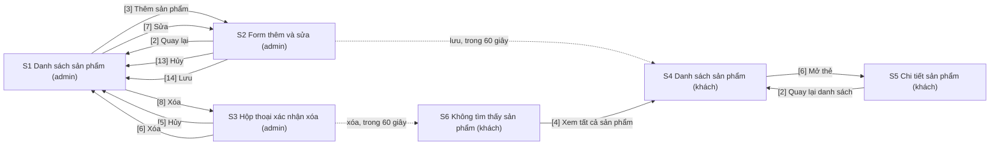
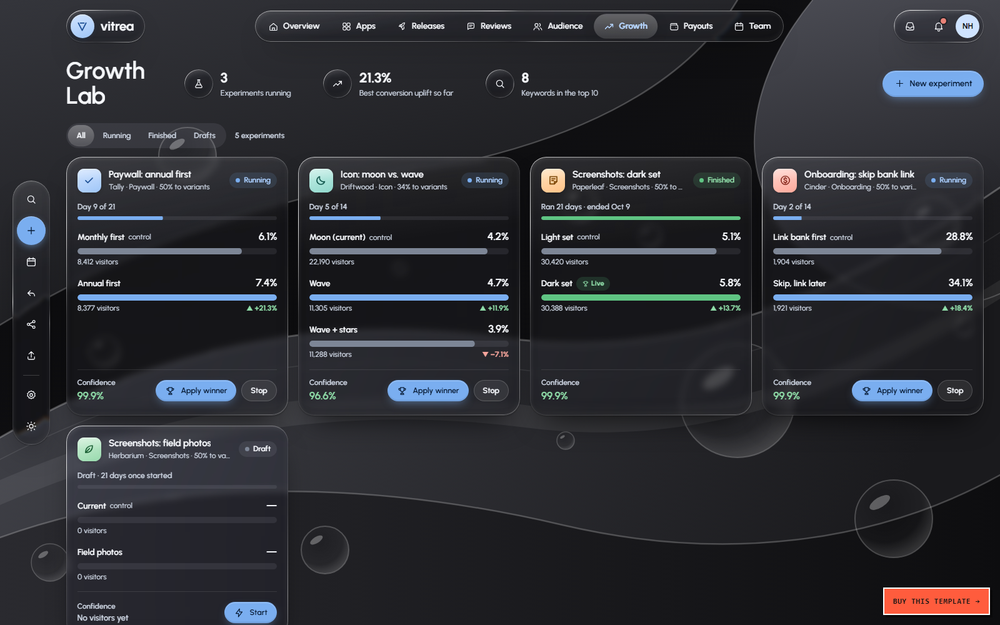
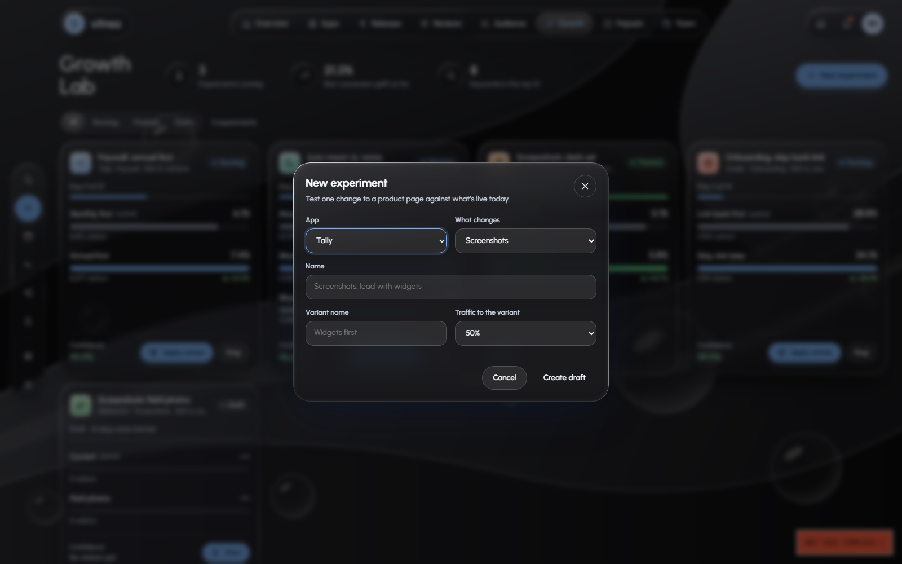
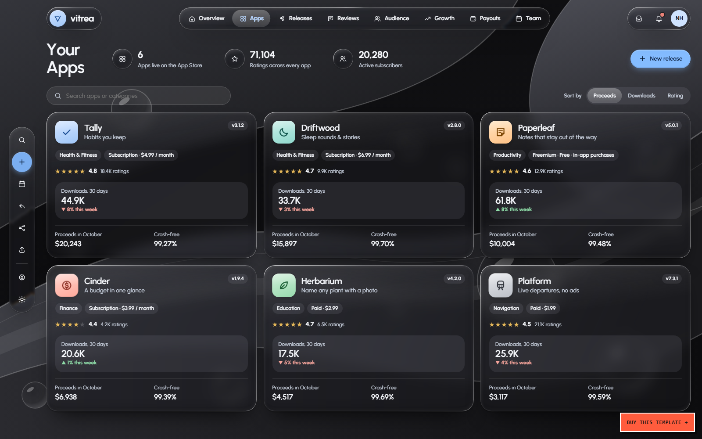
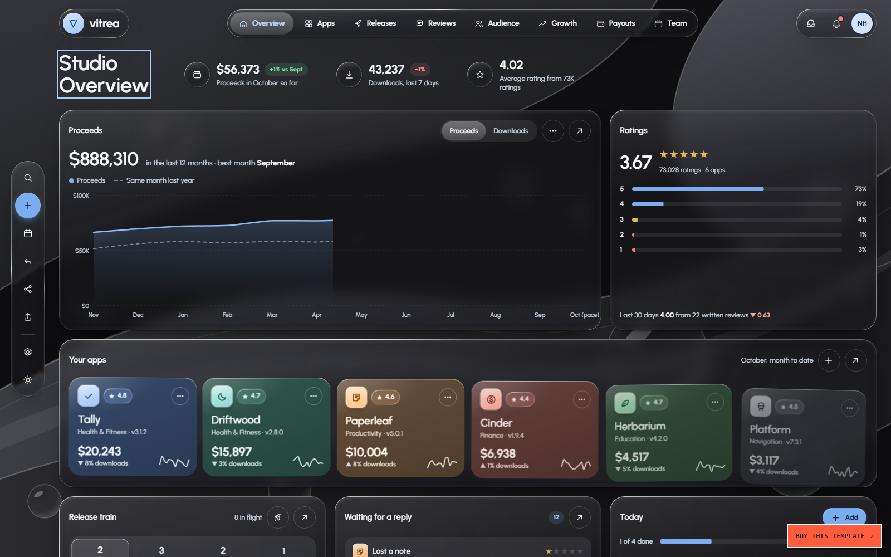

# Design: Danh mục sản phẩm

> **Epic:** SHOP-7 · **Jira:** https://phunghuutung12b4.atlassian.net/browse/SHOP-7 · **Spec:** docs/specs/SHOP-7/spec.md · **Status:** Draft
>
> **Figma version:** none

## Screens

| Code | Name | Route | User story | Kind |
|---|---|---|---|---|
| S1 | Danh sách sản phẩm (admin) | `/products` | US1 Quản trị viên xem và tìm danh sách sản phẩm | Image |
| S2 | Form thêm và sửa sản phẩm (admin) | `/products/new`, `/products/:productId/edit` | US2 Quản trị viên thêm sản phẩm; US3 Quản trị viên sửa và ẩn sản phẩm | Image |
| S3 | Hộp thoại xác nhận xóa (admin) | `/products`, hộp thoại mở trên S1 | US4 Quản trị viên xóa sản phẩm | ASCII |
| S4 | Danh sách sản phẩm (khách) | `/[locale]/products` | US5 Khách tìm và sắp xếp danh sách sản phẩm | Image |
| S5 | Chi tiết sản phẩm (khách) | `/[locale]/products/[slug]` | US6 Khách xem chi tiết sản phẩm | ASCII |
| S6 | Không tìm thấy sản phẩm (khách) | `/[locale]/products/[slug]`, HTTP 404 | US6 Khách xem chi tiết sản phẩm | ASCII |

AC7 (gọi thẳng API), AC27 (thẻ meta, JSON-LD) và AC28 (sitemap) không hiện ra màn hình, nên không có khối nào gắn với chúng. Chữ của giao diện viết ở YAML dưới đây, bản `vi` và bản `en`; giá luôn theo `formatPrice` (`1.250.000 ₫`) ở cả hai ngôn ngữ.

Quyết định ngày 2026-11-15, khi bạn đồng ý các đề xuất của `ux`:

- **S2 là trang riêng, không phải hộp thoại** như ảnh 02, vì SPEC liệt kê thêm và sửa là route và form có mô tả tới 5.000 ký tự. S2 dùng kiểu thẻ, nhãn, ô nhập, nút của hộp thoại ở ảnh; hộp thoại chỉ dùng cho S3. Đường dẫn do `sa` chốt trong plan; design dùng `/products/new` và `/products/:productId/edit` (hiện `admin` có `/admin/products/:productId/edit` sau lớp đăng nhập).
- **S5 không có ảnh.** `05-app-detail.png` không phải trang chi tiết: thanh điều hướng ở mục Apps nhưng nội dung là trang “Studio Overview”, giống ảnh 04, nên có vẻ ảnh chụp lúc đang chuyển trang. Ảnh 05 không đưa vào `design/`. S5 vẽ bằng ASCII, dựng từ thẻ kính và ô “well” của ảnh 03. Nếu sau này có ảnh chi tiết thật, đổi S5 thành màn hình Ảnh.
- **Chữ ngoài SPEC** (trạng thái trống, lỗi, đang tải, “Đã lưu sản phẩm”, cảnh báo đổi slug, chữ 404, nhãn Active và Hidden) do `ux` viết ở YAML. Đổi chữ chỉ sửa file i18n.
- **Khung trang.** Bỏ thanh công cụ dọc bên trái của ảnh 04 (tìm, thêm, lịch, chia sẻ…): đó là công cụ của template, không phải của sản phẩm. `user` hiện chưa có thanh điều hướng, nên S4 đến S6 thêm viên thuốc điều hướng với ba đường dẫn có sẵn (Trang chủ, Sản phẩm, Giới thiệu). `admin` giữ các mục đang có; nút “thanh bên” demo của `admin` không vẽ ở S1 và S2, và `ba` hay `sa` quyết có gỡ nó khỏi `admin` hay không.

## Flow

Mũi tên liền là thao tác của người dùng; mũi tên đứt là tác động giữa hai app: một thay đổi lưu ở `admin` hiện ở trang khách trong vòng 60 giây.



## Screen Details

### S1 · Danh sách sản phẩm (admin)



```yaml
screen: S1
route: /products
screenshot: "chụp bằng Playwright ngày 2026-11-14, trang Growth của trang mẫu https://demo.codeandchill.store/vitrea/#/growth, 1600x1000, giao diện tối (bạn chọn ở Phiên 30 · Lượt 5). Ảnh cho tiêu đề trang, bộ lọc nút phân đoạn, nút chính ở góc phải, huy hiệu trạng thái; bảng của trang nằm dưới phần chụp nên không có trong ảnh"
blocks:
  1:
    name: Thanh điều hướng
    type: nav
    content: "Ba viên thuốc như thanh trên cùng của ảnh. Trái: tên app “tungph7 codebase”. Giữa: Trang chủ, Sản phẩm (đang chọn), Giới thiệu. Phải: đổi ngôn ngữ, đổi giao diện, Đăng nhập, giữ như `admin` đang có. Không có thanh công cụ dọc bên trái của ảnh, và không vẽ nút “thanh bên” demo"
    behavior: "`admin` thiết kế cho máy tính, từ 1024 px (SPEC: quản trị viên dùng trên máy tính); không có bố cục điện thoại"
    a11y: "`<nav>` có nhãn “Điều hướng chính”; mục đang chọn có aria-current=page"
  2:
    name: Tiêu đề trang
    type: heading
    content:
      vi: "Sản phẩm"
      en: "Products"
    a11y: Là h1 duy nhất của trang
  3:
    name: Nút Thêm sản phẩm
    type: button
    content:
      vi: "Thêm sản phẩm"
      en: "Add product"
    behavior: Nút chính ở góc phải của hàng tiêu đề, như nút “New experiment” của ảnh. Sang S2 ở chế độ thêm
    ac: [AC5]
  4:
    name: Bộ lọc trạng thái
    type: input
    content:
      vi: "Tất cả, Đang bán, Ẩn; nhãn đếm bên phải “25 sản phẩm”"
      en: "All, Active, Hidden; count label on the right “25 products”"
    behavior: "Nút phân đoạn như “All, Running, Finished, Drafts” của ảnh, nhãn đếm như “5 experiments”. Mặc định Tất cả. Chọn một mục thì đổi `?status=` (all, active, hidden) và về trang 1. Số đếm là số sản phẩm khớp bộ lọc và từ khóa, không phải số của trang"
    a11y: "Nhóm có nhãn “Lọc theo trạng thái”, mục đang chọn aria-pressed=true; nhãn đếm là vùng role=status để trình đọc màn hình đọc lại sau khi lọc"
    ac: [AC3, AC4]
  5:
    name: Ô tìm theo tên
    type: input
    content:
      vi: "Nhãn ẩn “Tìm theo tên”, placeholder “Tìm theo tên sản phẩm…”"
      en: "Hidden label “Search by name”, placeholder “Search by product name…”"
    behavior: "Viên thuốc có biểu tượng kính lúp bên trái, như ô tìm của ảnh 03, nằm bên phải hàng bộ lọc. Gõ xong 300 ms thì đổi `?q=` và về trang 1. Tối đa 100 ký tự. Không phân biệt chữ hoa, chữ thường hay dấu (do API xử lý)"
    a11y: "type=search, có nhãn ẩn; kết quả đổi thì [4] đọc lại số đếm"
    ac: [AC2, AC4]
  6:
    name: Bảng sản phẩm
    type: table
    content: "Nằm trong một thẻ kính như khung “table section” của trang mẫu. Cột: Sản phẩm (ô giữ chỗ 40 px, tên, slug mờ bên dưới), Giá bán (căn phải, `1.250.000 ₫`), Trạng thái, Tình trạng, Thao tác. Mới nhất trước, 20 dòng mỗi trang. Huy hiệu Đang bán (xanh dương), Ẩn (xám), Còn hàng (xanh lá), Hết hàng (vàng hổ phách), luôn có chấm và chữ. Bảng không có trong ảnh 01 (nằm dưới phần chụp): dòng cao 64 px, đường kẻ line, hover surface-2 là ước lượng của `ux`, cùng token “table header cell” và “table section” của Epic. Dưới 1024 px bảng cuộn ngang trong thẻ của nó, vùng cuộn có tabindex=0 và nhãn “Danh sách sản phẩm”"
    states:
      loading: 6 dòng khung xương, vùng aria-busy=true
      error: "Dòng thông báo “Không tải được danh sách sản phẩm.” (en “Couldn't load the products.”) kèm nút phụ “Thử lại” (en “Try again”), role=alert"
      hover: Nền dòng đổi sang surface-2
    a11y: "`<table>` có `<caption>` ẩn “Danh sách sản phẩm”, tiêu đề cột `<th scope=col>`; huy hiệu có chữ nên không dựa vào màu"
    ac: [AC1, AC10, AC11]
  7:
    name: Nút Sửa của dòng
    type: link
    content:
      vi: "Sửa"
      en: "Edit"
    behavior: Nút phụ nhỏ ở cuối dòng. Sang S2 ở chế độ sửa, cho sản phẩm của dòng
    a11y: "aria-label “Sửa Áo thun cổ tròn”: có tên sản phẩm"
    ac: [AC9]
  8:
    name: Nút Xóa của dòng
    type: button
    content:
      vi: "Xóa"
      en: "Delete"
    behavior: Nút phụ nhỏ, chữ màu bad. Mở S3 cho sản phẩm của dòng. Khi S3 đóng mà không xóa, focus về nút này
    a11y: "aria-label “Xóa Quần jean nam”: có tên sản phẩm"
    ac: [AC14]
  9:
    name: Thông báo trạng thái trống
    type: text
    content:
      vi: "Không có sản phẩm nào khớp; hoặc khi chưa có sản phẩm nào: “Chưa có sản phẩm nào.”, kèm nút chính “Thêm sản phẩm”"
      en: "No matching products; or when there are none at all: “No products yet.”, with the primary button “Add product”"
    behavior: Thay phần thân bảng. Câu “Chưa có sản phẩm nào.” chỉ hiện khi không có từ khóa và bộ lọc là Tất cả
    a11y: role=status
    ac: [AC2]
  10:
    name: Nút Xóa bộ lọc
    type: button
    content:
      vi: "Xóa bộ lọc"
      en: "Clear filters"
    behavior: Chỉ hiện cùng [9] khi không khớp. Bỏ `q`, `status` và `page`; focus về [5]
    ac: [AC2]
  11:
    name: Phân trang
    type: nav
    content:
      vi: "Dòng “Hiển thị 1–20 trên 25”, nút Trước, số trang, nút Sau"
      en: "“Showing 1–20 of 25”, Previous, page numbers, Next"
    behavior: "Đổi `?page=`, 20 sản phẩm mỗi trang. Trước khóa ở trang 1, Sau khóa ở trang cuối. Ẩn khi chỉ có một trang. `page` không hợp lệ thì dùng trang 1. Tải lại hay mở cùng đường dẫn ở tab khác thì thấy cùng từ khóa, bộ lọc và trang"
    a11y: "`<nav>` có nhãn “Phân trang”, trang hiện tại có aria-current=page"
    ac: [AC4]
  12:
    name: Thông báo kết quả
    type: toast
    content:
      vi: "“Đã thêm sản phẩm”, “Đã lưu sản phẩm”, “Đã xóa sản phẩm”"
      en: "“Product added”, “Product saved”, “Product deleted”"
    behavior: "Hiện ở đáy giữa màn hình sau khi S2 lưu xong hoặc S3 xóa xong. Chữ “Đã lưu sản phẩm” do ux đề xuất, AC9 không nêu chữ"
    a11y: "role=status; ở lại 6 giây, dừng khi rê chuột hay có focus, có nút đóng"
    ac: [AC5, AC15]
```

### S2 · Form thêm và sửa sản phẩm (admin)



```yaml
screen: S2
route: "/products/new (thêm) và /products/:productId/edit (sửa)"
screenshot: "chụp bằng Playwright ngày 2026-11-14, hộp thoại “New experiment” của trang Growth ở trang mẫu https://demo.codeandchill.store/vitrea/#/growth, 1600x1000, giao diện tối. Ảnh là hộp thoại; S2 là trang riêng dùng kiểu thẻ, nhãn, ô nhập, nút của hộp thoại đó"
blocks:
  1:
    name: Thanh điều hướng
    type: nav
    content: Như S1.1, mục Sản phẩm đang chọn
  2:
    name: Liên kết Quay lại danh sách
    type: link
    content:
      vi: "← Sản phẩm"
      en: "← Products"
    behavior: Về S1, không lưu
  3:
    name: Tiêu đề form
    type: heading
    content:
      vi: "Thêm sản phẩm / Sửa sản phẩm; dòng phụ “Khách chỉ thấy sản phẩm ở trạng thái Đang bán.”"
      en: "Add product / Edit product; subtitle “Customers only see products that are Active.”"
    states:
      loading: "Chế độ sửa: khung xương cho tiêu đề và các ô trong lúc tải sản phẩm"
      not-found: "Chế độ sửa, mã không có hay sản phẩm đã bị xóa: thay form bằng “Không tìm thấy sản phẩm này. Có thể nó đã bị xóa.” (en “We couldn't find this product. It may have been deleted.”) và liên kết về S1"
    a11y: Là h1 duy nhất của trang; dòng phụ nằm ngay dưới, như “Test one change…” ở ảnh
  4:
    name: Khung form
    type: card
    content: "Thẻ kính (bo 26, đệm 18) rộng tối đa 640 px, căn giữa. Desktop: [6], [7], [8] chiếm cả hàng; [9] và [10] cạnh nhau, [11] và [12] cạnh nhau, mỗi ô nửa hàng, cách 16 px, như hai cột của ảnh; [13] và [14] căn phải ở cuối thẻ. Dưới 640 px: một cột"
  5:
    name: Thông báo của form
    type: text
    content:
      vi: "Xung đột: “Sản phẩm vừa được sửa ở nơi khác. Tải lại để xem bản mới nhất.” kèm nút phụ “Tải lại”. Lỗi chung: “Không lưu được. Vui lòng thử lại.”"
      en: "Conflict: “This product was just edited elsewhere. Reload to see the latest version.” with the secondary button “Reload”. General error: “Couldn't save. Please try again.”"
    behavior: "Banner trên đầu form, ẩn khi không có gì. Xung đột: lần lưu bị từ chối, không ghi đè bản của tab kia, mọi thứ đã nhập còn nguyên; chỉ nút Tải lại mới nạp lại trang. Lỗi chung: giữ nguyên dữ liệu, nút Lưu bấm lại được"
    a11y: role=alert, focus không bị kéo đi
    ac: [AC13]
  6:
    name: Ô Tên sản phẩm
    type: input
    content:
      vi: "Nhãn “Tên sản phẩm”, placeholder “vd. Áo thun cổ tròn”, bộ đếm “n/150”"
      en: "Label “Product name”, placeholder “e.g. Basic round-neck tee”, counter “n/150”"
    validation: "Bắt buộc. Bỏ khoảng trắng đầu và cuối rồi dài 1–150 ký tự. Lỗi trống: “Nhập tên sản phẩm” (en “Enter a product name”). Lỗi dài: “Tên tối đa 150 ký tự” (en “Name must be 150 characters or fewer”)"
    a11y: "Nhãn gắn với ô, required; lỗi gắn bằng aria-describedby và aria-invalid; khi lưu lỗi, focus về ô sai đầu tiên"
    ac: [AC5, AC6]
  7:
    name: Ô Slug
    type: input
    content:
      vi: "Nhãn “Đường dẫn (slug)”, phần đầu cố định “/products/”"
      en: "Label “URL slug”, fixed prefix “/products/”"
    behavior: "Thêm: ô tự điền từ tên khi gõ tên (`Đầm maxi đỏ` ra `dam-maxi-do`) cho tới khi quản trị viên tự sửa ô. Khi chưa sửa tay, dòng gợi ý “Tự sinh từ tên. Nếu đã có, hệ thống thêm -2, -3…” (en “Generated from the name. If taken, -2, -3… is added.”) và form để `api` tự sinh slug, nên slug lưu có thể là `-2`. Sửa: không đổi theo tên, hiện slug đã lưu"
    validation: "Chữ thường a–z, số và dấu gạch ngang đơn; không bắt đầu hay kết thúc bằng gạch ngang; tối đa 100 ký tự. Lỗi định dạng: “Chỉ dùng chữ thường a–z, số và dấu gạch ngang; không bắt đầu hay kết thúc bằng dấu gạch ngang.” (en “Use lowercase a–z, digits and hyphens only, with no hyphen at the start or end.”). Lỗi dài: “Slug tối đa 100 ký tự” (en “Slug must be 100 characters or fewer”). Trùng slug tự gõ: “Slug này đã được dùng” (en “This slug is already in use”), ngay dưới ô, không lưu"
    states:
      slug-changed: "Chế độ sửa, slug khác slug đã lưu: dòng cảnh báo ngay dưới ô, màu warn kèm biểu tượng, “Đường dẫn cũ /products/ao-thun-co-tron sẽ không mở được nữa.” (en “The old link /products/ao-thun-co-tron will stop working.”). Mất đi khi gõ lại slug cũ"
    a11y: "Cảnh báo role=status; lỗi như [6]"
    ac: [AC5, AC6, AC8, AC12]
  8:
    name: Ô Mô tả
    type: input
    content:
      vi: "Nhãn “Mô tả (không bắt buộc)”, vùng văn bản 6 dòng, bộ đếm “n/5000”, gợi ý “Xuống dòng được giữ nguyên. Thẻ HTML hiện như chữ, không có tác dụng.”"
      en: "Label “Description (optional)”, 6-row text area, counter “n/5000”, hint “Line breaks are kept. HTML tags show as plain text.”"
    validation: "Tối đa 5.000 ký tự, không bắt buộc, không từ chối ký tự `<` hay `>`. Lỗi: “Mô tả tối đa 5.000 ký tự” (en “Description must be 5,000 characters or fewer”)"
    behavior: Kéo giãn theo chiều dọc được
    ac: [AC6]
  9:
    name: Ô Giá bán
    type: input
    content:
      vi: "Nhãn “Giá bán (₫)”, hậu tố “₫”"
      en: "Label “Price (₫)”, suffix “₫”"
    validation: "Bắt buộc, số nguyên đồng từ 1 tới 999.999.999. Dấu chấm là dấu nhóm hàng nghìn: `250.000` là 250000. Rỗng, 0 hay không phải số: “Giá bán phải lớn hơn 0” (en “Price must be greater than 0”). Có phần lẻ như `250000,5`: “Giá phải là số nguyên đồng” (en “Price must be a whole number of đồng”). Quá lớn: “Giá tối đa 999.999.999 ₫” (en “Price can't exceed 999.999.999 ₫”)"
    behavior: "Bàn phím số (inputmode=numeric). Khi rời ô, hiện lại có dấu nhóm: `450000` thành `450.000`"
    ac: [AC5, AC6, AC9]
  10:
    name: Ô Giá gốc
    type: input
    content:
      vi: "Nhãn “Giá gốc (₫) (không bắt buộc)”, gợi ý “Để trống nếu không giảm giá. Có giá gốc thì khách thấy giá gạch ngang và phần trăm giảm.”"
      en: "Label “Compare-at price (₫) (optional)”, hint “Leave empty if there's no discount. With a compare-at price, customers see it struck through with the percentage off.”"
    validation: "Nếu có: số nguyên, lớn hơn giá bán, tối đa 999.999.999, cùng cách nhập như [9]. Lỗi: “Giá gốc phải lớn hơn giá bán” (en “Compare-at price must be greater than the price”)"
    ac: [AC6, AC9]
  11:
    name: Chọn Trạng thái
    type: input
    content:
      vi: "Nhóm “Trạng thái”: Đang bán, Ẩn; gợi ý “Ẩn: khách không thấy sản phẩm và trang chi tiết trả 404.”"
      en: "Group “Status”: Active, Hidden; hint “Hidden: customers can't see the product and its page returns 404.”"
    behavior: Hai lựa chọn dạng nút phân đoạn. Thêm sản phẩm mới mặc định Đang bán
    a11y: "`<fieldset>` và `<legend>`, là nhóm radio; mũi tên đổi lựa chọn"
    ac: [AC10]
  12:
    name: Chọn Tình trạng
    type: input
    content:
      vi: "Nhóm “Tình trạng”: Còn hàng, Hết hàng; gợi ý “Hết hàng vẫn hiện trong danh sách của khách.”"
      en: "Group “Availability”: In stock, Out of stock; hint “Out-of-stock products still show in the customer list.”"
    behavior: Như [11]. Thêm sản phẩm mới mặc định Còn hàng
    a11y: Như [11]
    ac: [AC11]
  13:
    name: Nút Hủy
    type: button
    content:
      vi: "Hủy"
      en: "Cancel"
    behavior: Nút phụ. Về S1, bỏ những gì đã nhập, không lưu
  14:
    name: Nút Lưu
    type: button
    content:
      vi: "Thêm sản phẩm (chế độ thêm), Lưu thay đổi (chế độ sửa)"
      en: "Add product (add mode), Save changes (edit mode)"
    behavior: "Nút chính. Kiểm cả form: có lỗi thì không gửi, hiện lỗi dưới từng ô sai, giữ nguyên những gì đã nhập, focus về ô sai đầu tiên. Hợp lệ thì gửi; thành công về S1 và hiện S1.12. Nút luôn bấm được, trừ lúc đang lưu, vì AC6 cần hiện lỗi ở từng ô sau khi lưu; nền như nút chính (nút “Create draft” ở ảnh 02 không có nền, không lấy làm mẫu)"
    states:
      saving: "Chữ “Đang lưu…” (en “Saving…”), khóa nút, aria-busy=true"
    ac: [AC5, AC9]
```

### S3 · Hộp thoại xác nhận xóa (admin)

```text
S3 · Hộp thoại xác nhận xóa · desktop
+--------------------------------------------------------+
| [1] Xóa "Quần jean nam"?                       [2] (X) |
|                                                        |
| [3] Việc xóa không hoàn tác được.                      |
| [4] Nếu chỉ muốn tạm ngừng bán, hãy chọn Ẩn.           |
|                                                        |
|                               [5] (Hủy)   [6] (Xóa)    |
+--------------------------------------------------------+
```

```yaml
screen: S3
route: "/products, hộp thoại mở trên S1, không có đường dẫn riêng"
blocks:
  1:
    name: Tiêu đề hộp thoại
    type: heading
    content:
      vi: "Xóa “{tên sản phẩm}”?"
      en: "Delete “{product name}”?"
    behavior: "Hộp thoại kính như hộp thoại của trang mẫu (Design System, Component Hộp thoại), rộng tối đa 560 px, phía sau tối đi và mờ. Ở điện thoại rộng 92% màn hình, bố cục không đổi"
    a11y: "role=alertdialog, aria-modal=true, aria-labelledby là [1], aria-describedby là [3] và [4]. Mở: focus vào [5], an toàn hơn [6]. Tab xoay trong hộp thoại, Esc như Hủy, phần phía sau không nhận focus. Đóng: focus về S1.8 của dòng"
    ac: [AC14]
  2:
    name: Nút Đóng
    type: button
    content: Biểu tượng dấu nhân trong vòng tròn 40 px, góc phải trên, như nút đóng của ảnh 02
    behavior: Như [5]
    a11y: "aria-label “Đóng” (en “Close”)"
  3:
    name: Cảnh báo không hoàn tác
    type: text
    content:
      vi: "Việc xóa không hoàn tác được."
      en: "This can't be undone."
    ac: [AC14]
  4:
    name: Gợi ý chọn Ẩn
    type: text
    content:
      vi: "Nếu chỉ muốn tạm ngừng bán, hãy chọn Ẩn."
      en: "To stop selling it for now, set its status to Hidden instead."
    ac: [AC14]
  5:
    name: Nút Hủy
    type: button
    content:
      vi: "Hủy"
      en: "Cancel"
    behavior: Nút phụ. Đóng hộp thoại, sản phẩm còn nguyên
    ac: [AC14]
  6:
    name: Nút Xóa
    type: button
    content:
      vi: "Xóa"
      en: "Delete"
    behavior: "Nút nguy hiểm (nền destructive). Xóa hẳn sản phẩm; thành công thì đóng hộp thoại, S1 tải lại danh sách và hiện “Đã xóa sản phẩm”. Slug của sản phẩm dùng lại được"
    states:
      deleting: "Chữ “Đang xóa…” (en “Deleting…”), khóa [2], [5] và [6]"
      error: "Giữ hộp thoại, hiện trên hàng nút “Không xóa được. Vui lòng thử lại.” (en “Couldn't delete. Please try again.”), role=alert"
    ac: [AC15]
```

### S4 · Danh sách sản phẩm (khách)




```yaml
screen: S4
route: "/[locale]/products, locale là vi hoặc en"
screenshot: "chụp bằng Playwright ngày 2026-11-14, trang Apps (ảnh đầu: ô tìm, nút Sort by, lưới thẻ có huy hiệu) và trang Overview (ảnh sau: khung trang, hàng ô màu nhóm “Your apps”) của trang mẫu https://demo.codeandchill.store/vitrea/, 1600x1000, giao diện tối (bạn chọn trang mẫu ở Phiên 30 · Lượt 5)"
blocks:
  1:
    name: Thanh điều hướng
    type: nav
    content: "Ba viên thuốc như thanh trên cùng của hai ảnh. Trái: tên site. Giữa: Trang chủ, Sản phẩm (đang chọn), Giới thiệu, ba đường dẫn có sẵn; `user` hiện chưa có thanh điều hướng nên đây là phần mới. Phải: tài khoản (như `AuthStatus` đang có), đổi ngôn ngữ vi và en, đổi giao diện Sáng, Tối, Hệ thống. Không có thanh công cụ dọc bên trái của ảnh"
    behavior: "Dưới 768 px: hàng 1 gồm tên site và khối tiện ích (đổi ngôn ngữ dạng “VI/EN”, đổi giao diện và tài khoản dạng nút biểu tượng); hàng 2 là viên thuốc điều hướng chiếm hết bề rộng, ba mục chỉ có chữ, không có menu ẩn"
    a11y: "`<nav>` có nhãn “Điều hướng chính”; mục đang chọn có aria-current=page"
  2:
    name: Tiêu đề trang
    type: heading
    content:
      vi: "Sản phẩm"
      en: "Products"
    behavior: "Chữ lớn bên trái như “Your Apps” của ảnh 03, không có ô số liệu bên phải. Bỏ dòng giới thiệu demo của template"
    a11y: Là h1 duy nhất của trang
  3:
    name: Ô tìm theo tên
    type: input
    content:
      vi: "Nhãn ẩn “Tìm theo tên”, placeholder “Tìm sản phẩm…”"
      en: "Hidden label “Search by name”, placeholder “Search products…”"
    behavior: "Viên thuốc rộng, biểu tượng kính lúp bên trái, như ô “Search apps or categories” của ảnh 03. Là `<form role=search>` kiểu GET: Enter thì đổi `?q=` (tên tham số do plan chốt), bỏ số đã xem, về 24 sản phẩm đầu. Tối đa 100 ký tự. Sau khi tải, ô giữ từ khóa"
    a11y: "type=search, có nhãn ẩn, enterkeyhint=search"
    ac: [AC18]
  4:
    name: Chọn sắp xếp
    type: input
    content:
      vi: "Nhãn “Sắp xếp”; lựa chọn Mới nhất, Giá thấp đến cao, Giá cao đến thấp, và Liên quan nhất chỉ khi đang tìm"
      en: "Label “Sort by”; options Newest, Price: low to high, Price: high to low, and Most relevant only while searching"
    behavior: "Ô chọn (select) nằm bên phải hàng tìm kiếm, ở vị trí “Sort by” của ảnh 03. Dùng ô chọn thay cho nút phân đoạn của ảnh, vì bốn lựa chọn bằng chữ tiếng Việt không vừa một hàng ở 320 px. Dưới 768 px [3] và [4] xếp chồng, mỗi ô một hàng. Mặc định Mới nhất; khi đang tìm thì mặc định Liên quan nhất. Đổi là áp dụng ngay, không có nút Áp dụng; đổi `?sort=` và về 24 sản phẩm đầu"
    a11y: Là `<select>` gốc có nhãn nhìn thấy
    ac: [AC18, AC19, AC20]
  5:
    name: Lưới sản phẩm
    type: list
    content: "Lưới thẻ như ảnh 03. Cột: 1 dưới 640 px, 2 từ 640, 3 từ 1024, 4 từ 1440; khoảng cách 16 px; 24 thẻ mỗi lần tải, chia hết cho 1, 2, 3 và 4 cột. Chỉ có sản phẩm Đang bán, mới nhất trước, không có nút xóa. Ở 320 px không có thanh cuộn ngang"
    states:
      loading: "8 thẻ khung xương, vùng aria-busy=true"
      error: "Trang lỗi có sẵn của app “Đã xảy ra lỗi” kèm nút “Thử lại”"
    a11y: "`<ul>` có nhãn “Danh sách sản phẩm”, mỗi thẻ là một `<li>`"
    ac: [AC16, AC21]
  6:
    name: Thẻ sản phẩm
    type: link
    content: "Thẻ kính như thẻ “Tally” của ảnh 03: ô màu giữ chỗ 4:3 với chữ cái đầu của tên, màu nhóm như ô “Your apps” của ảnh 04, chọn theo `id` của sản phẩm (Design System, Ô giữ chỗ); dưới ô là tên (tối đa 2 dòng), giá bán, và khi có giá gốc thì giá gốc gạch ngang kèm “-16%”. Hết hàng thì có huy hiệu “Hết hàng” (en “Out of stock”) đè góc trên trái ô màu; còn hàng thì không có huy hiệu"
    behavior: Bấm thẻ mở S5 của sản phẩm. Hover nâng thẻ 2 px và sáng viền
    states:
      out-of-stock: Có huy hiệu Hết hàng, giá và tên vẫn như thường
    a11y: "Cả thẻ là một liên kết, chữ của liên kết là tên. Đọc ra “Áo thun cổ tròn, 1.250.000 ₫, giá gốc 1.500.000 ₫, giảm 16%, Hết hàng”. Ô màu aria-hidden; “-16%” có chữ ẩn “Giảm”, giá gốc có chữ ẩn “Giá gốc:”"
    ac: [AC16, AC17]
  7:
    name: Thông báo không có kết quả
    type: text
    content:
      vi: "Không tìm thấy sản phẩm nào cho “xyz”; hoặc khi chưa có sản phẩm nào: “Chưa có sản phẩm nào.”"
      en: "No products found for “xyz”; or when there are none at all: “No products yet.”"
    behavior: Thay lưới và [9], [10]. Câu “Chưa có sản phẩm nào.” chỉ hiện khi không có từ khóa
    a11y: role=status
    ac: [AC23]
  8:
    name: Liên kết Xóa tìm kiếm
    type: link
    content:
      vi: "Xóa tìm kiếm"
      en: "Clear search"
    behavior: Chỉ hiện cùng [7] khi đang tìm. Về `/[locale]/products` không tham số
    ac: [AC23]
  9:
    name: Dòng tiến độ
    type: text
    content:
      vi: "Đã xem 24 trên 30 sản phẩm"
      en: "Viewed 24 of 30 products"
    behavior: Căn giữa ngay trên nút [10], chữ hint. Thay badge đếm của template. Cập nhật sau mỗi lần Xem thêm
    a11y: "role=status, aria-live=polite"
    ac: [AC21]
  10:
    name: Nút Xem thêm
    type: button
    content:
      vi: "Xem thêm"
      en: "Load more"
    behavior: "Nút phụ căn giữa. Tải 24 sản phẩm kế tiếp, nối bên dưới, giữ 24 sản phẩm đầu; cập nhật số đã xem trong URL (tên tham số do plan chốt) bằng replace, không thêm mục lịch sử. Focus chuyển tới thẻ mới đầu tiên. Hết sản phẩm thì ẩn nút. Đường dẫn có số đã xem, tải lại sẽ hiện đủ"
    states:
      loading: "Chữ “Đang tải…” (en “Loading…”), khóa nút, aria-busy=true"
      error: "Dòng “Không tải thêm được. Vui lòng thử lại.” (en “Couldn't load more. Please try again.”) trên nút, role=alert; nút bấm lại được"
    ac: [AC21, AC22]
  11:
    name: Chân trang
    type: text
    content: Dòng bản quyền của `SiteFooter` đang có, chữ hint 12,5 px, căn giữa
    a11y: "`<footer>`"
```

### S5 · Chi tiết sản phẩm (khách)

```text
S5 · Chi tiết sản phẩm · desktop
+----------------------------------------------------------------------------------+
| [1] Thanh điều hướng                                                             |
+----------------------------------------------------------------------------------+
| [2] < Sản phẩm                                                                   |
| +---------------------------+  +-----------------------------------------------+ |
| |                           |  | [4] Tên sản phẩm                              | |
| |                           |  | +-------------------------------------------+ | |
| |     [3] Ảnh giữ chỗ       |  | | [5] Giá bán  [6] Giá gốc  [7] -20%        | | |
| |     (chữ cái đầu tên)     |  | +-------------------------------------------+ | |
| |                           |  | [8] Tình trạng                                | |
| |                           |  |                                               | |
| +---------------------------+  | [9] Mô tả                                     | |
|                                | [10] Nội dung mô tả, nhiều dòng               | |
|                                +-----------------------------------------------+ |
+----------------------------------------------------------------------------------+
| [11] Chân trang                                                                  |
+----------------------------------------------------------------------------------+
```

```text
S5 · Chi tiết sản phẩm · mobile
+------------------------------+
| [1] Thanh điều hướng         |
+------------------------------+
| [2] < Sản phẩm               |
| +--------------------------+ |
| | [3] Ảnh giữ chỗ          | |
| +--------------------------+ |
| [4] Tên sản phẩm             |
| +--------------------------+ |
| | [5] Giá bán              | |
| | [6] Giá gốc  [7] -20%    | |
| +--------------------------+ |
| [8] Tình trạng               |
| [9] Mô tả                    |
| [10] Nội dung mô tả          |
+------------------------------+
| [11] Chân trang              |
+------------------------------+
```

```yaml
screen: S5
route: "/[locale]/products/[slug], locale là vi hoặc en"
blocks:
  1:
    name: Thanh điều hướng
    type: nav
    content: Như S4.1, mục Sản phẩm đang chọn
  2:
    name: Liên kết Quay lại danh sách
    type: link
    content:
      vi: "← Sản phẩm"
      en: "← Products"
    behavior: Về S4, không tham số
  3:
    name: Ảnh giữ chỗ
    type: image
    content: "Ô vuông 1:1, bo 22, màu nhóm của sản phẩm theo `id` (cùng màu với thẻ ở S4), chữ cái đầu của tên viết hoa, cỡ lớn. Desktop: nằm trong thẻ kính cùng [4] đến [10], chiếm 40% bề rộng bên trái. Điện thoại: rộng hết hàng, tỷ lệ 4:3"
    a11y: "aria-hidden=true: chữ cái đầu chỉ để trang trí, tên sản phẩm ở ngay [4]"
    ac: [AC24]
  4:
    name: Tên sản phẩm
    type: heading
    content: Tên đầy đủ của sản phẩm
    behavior: "26 px, đậm 700 (22 px ở điện thoại); xuống dòng không giới hạn, từ dài không bị tràn (overflow-wrap: anywhere)"
    a11y: Là h1 duy nhất của trang
    ac: [AC24]
  5:
    name: Giá bán
    type: text
    content: "Giá, như `200.000 ₫`, trong ô “well” lõm như ô “Downloads, 30 days” của ảnh 03, kèm nhãn nhỏ “Giá bán” (en “Price”). 34 px, đậm 700 (26 px ở điện thoại)"
    ac: [AC24]
  6:
    name: Giá gốc
    type: text
    content: "Giá gốc như `250.000 ₫`, gạch ngang, chữ hint 13,5 px, cạnh [5]. Không có giá gốc thì ẩn [6] và [7]"
    a11y: "Thẻ `<s>` kèm chữ ẩn “Giá gốc:” (en “Original price:”) vì trình đọc màn hình không đọc gạch ngang"
    ac: [AC24]
  7:
    name: Phần trăm giảm
    type: text
    content: "Huy hiệu bad “-20%”, làm tròn xuống, tối thiểu 1"
    a11y: "Có chữ ẩn “Giảm” (en “Off”) đứng trước"
    ac: [AC24]
  8:
    name: Tình trạng
    type: text
    content:
      vi: "Còn hàng; hoặc Hết hàng"
      en: "In stock; or Out of stock"
    behavior: "Huy hiệu good “Còn hàng” hay warn “Hết hàng”, có chấm và chữ. Trang không có nút mua vì giỏ hàng nằm ngoài Epic: chỗ đó để trống tới khi có Epic giỏ hàng, không vẽ nút khóa"
    ac: [AC24]
  9:
    name: Tiêu đề Mô tả
    type: heading
    content:
      vi: "Mô tả"
      en: "Description"
    behavior: Ẩn cùng [10] khi sản phẩm không có mô tả
    a11y: Là h2
    ac: [AC24]
  10:
    name: Nội dung mô tả
    type: text
    content: "Mô tả hai dòng hay nhiều dòng, giữ xuống dòng của người nhập, chữ text 14/500 (white-space: pre-line). Chuỗi như `<b>Mới</b><script>alert(1)</script>` hiện nguyên như chữ"
    a11y: Là text node trong `<p>`, không có HTML được hiểu
    ac: [AC24, AC25]
  11:
    name: Chân trang
    type: text
    content: Như S4.11
```

### S6 · Không tìm thấy sản phẩm (khách)

```text
S6 · Không tìm thấy sản phẩm · desktop
+------------------------------------------------------------+
| [1] Thanh điều hướng                                       |
+------------------------------------------------------------+
|                                                            |
|    [2] Không tìm thấy sản phẩm                             |
|    [3] Sản phẩm này không tồn tại hoặc không còn được bán. |
|    [4] (Xem tất cả sản phẩm)                               |
|                                                            |
+------------------------------------------------------------+
| [5] Chân trang                                             |
+------------------------------------------------------------+
```

```yaml
screen: S6
route: "/[locale]/products/[slug], HTTP 404"
blocks:
  1:
    name: Thanh điều hướng
    type: nav
    content: Như S4.1, mục Sản phẩm đang chọn
  2:
    name: Tiêu đề không tìm thấy
    type: heading
    content:
      vi: "Không tìm thấy sản phẩm"
      en: "Product not found"
    behavior: "Thẻ kính ở giữa trang. Cùng một trang cho slug chưa từng có, sản phẩm Ẩn và sản phẩm đã xóa, nên khách không biết sản phẩm Ẩn có tồn tại. Mã HTTP 404. Bố cục ở điện thoại không đổi"
    a11y: Là h1 duy nhất của trang
    ac: [AC26]
  3:
    name: Dòng giải thích
    type: text
    content:
      vi: "Sản phẩm này không tồn tại hoặc không còn được bán."
      en: "This product doesn't exist or is no longer available."
    ac: [AC26]
  4:
    name: Liên kết Xem tất cả sản phẩm
    type: link
    content:
      vi: "Xem tất cả sản phẩm"
      en: "View all products"
    behavior: Nút chính. Về S4, không tham số
    ac: [AC26]
  5:
    name: Chân trang
    type: text
    content: Như S4.11
```

## Design System

**App:** admin (S1, S2, S3) và user (S4, S5, S6) · **Design system của app:** chưa có (`docs/design-system/admin.md` và `docs/design-system/user.md` đều chưa có)

Giá trị đọc từ ảnh và từ token Epic đã đo ngày 2026-11-14 ở giao diện tối. Giao diện sáng do `ux` dựng (TW3) từ cùng các vai trò màu; mọi cặp chữ và nền ở cả hai giao diện đã tính tương phản WCAG AA. Dùng chung cho hai app. Mọi mục đều “mới” vì cả hai app chưa có file design system, nên `sa` đặt hai Task “Design system của admin” và “Design system của user” lên đầu plan.

Quyết định ngày 2026-11-15, khi bạn đồng ý các đề xuất của `ux`:

- **Chỉ lấy style, token và bố cục.** Ảnh trong `design/` chỉ để tham chiếu. Không dựng logo “vitrea”, dải “BUY THIS TEMPLATE”, tên các app, bong bóng và dải cong của trang mẫu; nền trang chỉ là gradient của bảng màu.
- **Giao diện sáng và hai chỗ của trang mẫu chưa đạt WCAG AA** đã sửa ở dòng `hint` và `control-border` (lý do ở hai dòng đó). Ô nhập vì vậy có viền đậm hơn ở ảnh 02.
- **Ảnh không có** nút nguy hiểm, ô nhập có lỗi, banner lỗi và cảnh báo, toast. Dùng các giá trị `ux` đề xuất trong bảng, lấy màu bad và warn của trang mẫu.
- **Giá trị ghi “ước lượng”** (huy hiệu “Running” và “Draft” không có số đo, vì token “status badge” của Epic có vẻ đo nhãn “5 experiments”; màu coral của “-16%”; cỡ chữ cái đầu và bo góc ô giữ chỗ ở dòng bảng; tiêu đề trang 34/36; thời lượng chuyển động) là ước lượng của `ux`. `fe-dev` đối chiếu từng giá trị với trang mẫu khi làm Task design system và ghi giá trị đo vào `docs/design-system/<app>.md`.

| Loại | Tên | Giá trị | Có hay mới |
|---|---|---|---|
| Màu | bg | Tối #111113, nền trang là gradient 135° #0c0c0e đến #131316; sáng #f2f4f8, gradient #eef1f6 đến #f6f8fb. Nền cả trang; không dựng các hình bong bóng và dải cong của trang mẫu | mới |
| Màu | surface | Tối #1e1e226b; sáng #ffffffb8. Thẻ, bảng, thanh điều hướng; đi cùng blur 14 px và bão hòa 175% | mới |
| Màu | solid | Tối #1d1d21; sáng #ffffff. Nền đặc thay surface khi không có `backdrop-filter` hay khi người dùng bật giảm độ trong suốt | mới |
| Màu | dialog | Tối #1c1c20db; sáng #fffffff0. Nền hộp thoại và toast | mới |
| Màu | text | Tối #f6f8fc; sáng #0f1724. Chữ chính, nhãn trường | mới |
| Màu | muted | Tối #c9d1de; sáng #3b475a. Chữ phụ, tiêu đề cột bảng, chữ huy hiệu Ẩn | mới |
| Màu | hint | Tối #9aa1ad (`--ink-mark` của trang mẫu); sáng #556074. Gợi ý, placeholder, slug dưới tên, giá gốc, chân trang. Thay `--faint` #7d8696 cho chữ, vì #7d8696 chỉ 3,7:1 ở mép sáng của thẻ và 4,0:1 làm placeholder | mới |
| Màu | control-border | Tối #7d8696 (`--faint` của trang mẫu); sáng #667184. Viền ô nhập, ô chọn, vùng văn bản; từ 3,8:1 so với nền ô. Viền #ffffff2e của trang mẫu chỉ 1,75:1 so với nền thẻ, dưới 3:1 của WCAG 1.4.11 | mới |
| Màu | line, line-2 | Tối #ffffff1a và #ffffff2e; sáng #0f17241a và #0f17242e. Đường kẻ, viền nút phụ, nền mục đang chọn của nút phân đoạn | mới |
| Màu | surface-2, well | Tối #ffffff14 và #c8c8d71a; sáng #0f17240d cho cả hai. Nền nút phụ và ô nhập; ô “well” chứa giá ở S5 | mới |
| Màu | accent | Tối #7aaef0; sáng #2b63c4. Nền nút chính | mới |
| Màu | on-accent | Tối #071a33; sáng #ffffff. Chữ trên accent, 7,6:1 và 5,7:1 | mới |
| Màu | accent-text | Tối #a9cdfc; sáng #1a56b0. Liên kết, chữ nhấn, 6,3:1 trở lên | mới |
| Màu | accent-line | Tối #8dbcf6; sáng #2a5db8. Vòng focus (2 px, cách 2 px), viền ô đang focus | mới |
| Màu | good | Chữ tối #8fdca8, sáng #166534; fill tối #5fc483, sáng #2f9e5b. Huy hiệu Còn hàng | mới |
| Màu | bad | Chữ tối #f6a59c, sáng #b42318; fill tối #e98278, sáng #d4493c. Lỗi ô nhập, huy hiệu “-16%”, chữ nút Xóa ở dòng | mới |
| Màu | warn | Chữ tối #f3cd7e, sáng #8a5300; fill tối #e4b759, sáng #c98a08. Huy hiệu Hết hàng, cảnh báo đổi slug | mới |
| Màu | info | Chữ tối #a9cdfc, sáng #1a56b0; fill tối #7aaef0, sáng #2b63c4. Huy hiệu Đang bán | mới |
| Màu | destructive | Tối nền #e98278 chữ #1a0a08 (7,3:1); sáng nền #b42318 chữ #ffffff (6,6:1). Nút Xóa của S3; `ux` đề xuất, ảnh không có nút nguy hiểm | mới |
| Màu | Màu nhóm (6) | Gradient 160°, chữ trên ô: blue #354a6a đến #283953, chữ #eef4fd; coral #6a423d đến #52322e, #fdeeeb; green #375741 đến #29432f, #eef9f1; orange #66503a đến #4e3d2b, #fdf3e6; teal #31574f đến #24433d, #ecf8f5; ink #3b3e46 đến #2c2e34, #f1f2f5. Ô giữ chỗ của sản phẩm; giống nhau ở hai giao diện, chữ từ 6,9:1 | mới |
| Màu | Tương phản đã tính | `ux` tính bằng công thức WCAG 2.1: mọi cặp chữ và nền ở trên từ 4,5:1 ở cả hai giao diện, kể cả mép sáng của thẻ (nền #2e2e30) và nền ô nhập; nền huy hiệu là màu fill ở 16% (tối) hay 14% (sáng), chữ trên đó từ 5,3:1 | mới |
| Font | family | `"Urbanist", ui-sans-serif, system-ui, -apple-system, "Segoe UI", sans-serif`. Google Fonts, OFL, tự host: `user` có `next/font/google` (giữ CSP `font-src 'self'`), `admin` tự thêm file font. Hiện `user` dùng Inter, `admin` dùng system-ui. `ux` chưa kiểm được Urbanist có đủ chữ có dấu tiếng Việt (ạ, ế, ữ, đ…): `fe-dev` kiểm bằng chrome-devtools khi làm Task design system. Nếu thiếu, giữ Urbanist cho chữ Latin và để chữ có dấu rơi về font dự phòng của `--font`; nếu nhìn lệch thì đổi sang một font OFL có tiếng Việt như Be Vietnam Pro, ghi vào mô tả PR (dependency) và `docs/design-system/<app>.md` | mới |
| Font | body | 14/20,3, 500. Chữ thường, nhãn trường 14/500 | mới |
| Font | Cỡ chữ | 11, 12, 12,5, 13,5, 14, 15, 17, 20, 22, 26, 34 px (`--fs-2xs` đến `--fs-display`) | mới |
| Font | Tiêu đề trang | 34/36, 700 ở desktop; 26 ở điện thoại. Ước lượng từ ảnh, Epic không đo | mới |
| Font | Tiêu đề hộp thoại | 20/29, 700, letter-spacing -0,3 px | mới |
| Font | Nút, tiêu đề cột, huy hiệu | Nút chính và nút hộp thoại 13,5/19,6, 600; nút phụ trong danh sách, huy hiệu, nút phân đoạn 12,5/18,1, 600; tiêu đề cột bảng 12/17,4, 600 | mới |
| Font | Giá | Trên thẻ 17/700; trang chi tiết 34/700 (26 ở điện thoại); giá gốc 13,5/500, gạch ngang | mới |
| Font | Chữ cái đầu của ô giữ chỗ | 700, cỡ khoảng 40% chiều cao ô. Ước lượng | mới |
| Khoảng cách | spacing | 4, 8, 10, 12, 14, 16, 18, 24, 28 px, đo từ trang mẫu: đệm thẻ 18; đệm nút 0 18 (cao 42) và 0 14 (cao 34); đệm ô nhập 10 14 (cao 44); đệm ô bảng 10 12; khoảng cách giữa các thẻ `--gap` 16; nhãn cách ô 4 | mới |
| Khoảng cách | gutter | Lề ngang `clamp(16px, 1.6vw, 28px)`; nội dung rộng tối đa `--app-max` 1840 px | mới |
| Bo góc, bóng | Bo góc | Thẻ 26 (`--r-card`), ô màu 22 (`--r-tile`), hộp thoại 30, ô nhập 14, nút và viên thuốc 999 (`--r-ctl`); ô giữ chỗ trong dòng bảng 12 (ước lượng) | mới |
| Bo góc, bóng | card-shadow tối | `inset 0 1px 1px #ffffff4d, inset 0 -1px 1px #ffffff1a, inset 3px 4px 12px -6px #ffffff38, inset -4px -6px 14px -8px #ffffff1f, inset 0 -16px 28px -18px #00000073, 0 1px 2px #0000004d, 0 24px 48px -22px #000000bf`. Thẻ và hộp thoại | mới |
| Bo góc, bóng | card-shadow sáng | `inset 0 1px 1px #ffffffcc, 0 1px 2px #0f17240f, 0 18px 40px -22px #0f172447`. `ux` đề xuất: các bóng trong màu trắng của giao diện tối không thấy được trên nền sáng | mới |
| Bo góc, bóng | button-shadow | Nút chính tối `inset 0 1px 0 #ffffff47, inset 0 -1px 0 #0000001f, 0 6px 16px -6px #7aaef0a6`; sáng `0 6px 16px -8px #2b63c499` (ước lượng) | mới |
| Bo góc, bóng | Kính | Thẻ: blur 14 px, bão hòa 175% (`--blur`, `--sat`). Nền sau hộp thoại: blur 30 px (`--blur-thick`) và tối đi. Không dùng bộ lọc SVG riêng của trang mẫu. Khi `prefers-reduced-transparency: reduce` hay thiếu `backdrop-filter`: dùng nền solid | mới |
| Chuyển động | ease | `cubic-bezier(.2, .8, .2, 1)`, 150 đến 250 ms (ước lượng); tắt khi `prefers-reduced-motion: reduce` | mới |
| Điểm ngắt | sm, md, lg, xl | 640, 768, 1024, 1440 px. `user` hỗ trợ từ 320 px, không có thanh cuộn ngang; cột lưới sản phẩm 1, 2, 3, 4; thanh điều hướng hai hàng dưới 768 px (S4.1). `admin` thiết kế cho từ 1024 px; dưới 1024 px bảng S1.6 cuộn ngang trong thẻ, form S2 một cột dưới 640 px. `ux` đề xuất, ảnh đều 1600 px nên không đo được | mới |
| Component | Nút chính | Cao 42, đệm 0 18, bo 999, chữ 13,5/600 màu on-accent, nền accent, button-shadow. hover sáng hơn 6%; focus-visible vòng accent-line; active lún 1 px; đang lưu: đổi chữ, aria-busy, khóa; không khóa trước khi gửi form | mới |
| Component | Nút phụ | Cao 42 (form, hộp thoại) hay 34 (danh sách, dòng bảng), bo 999, nền surface-2, viền line-2, chữ text 13,5/600 hay 12,5/600. Cùng trạng thái với nút chính; khóa thì mờ 50% | mới |
| Component | Nút nguy hiểm | Như nút chính, nền destructive. Chỉ dùng cho nút Xóa của S3 | mới |
| Component | Viên thuốc điều hướng | Thanh cao 49,6, bo 999, nền surface; mục cao 39,6, đệm 10 16, chữ 13,5/600; mục đang chọn nền surface-2 và aria-current=page; hover đổi nền surface-2. Ba viên: tên app, điều hướng, tiện ích | mới |
| Component | Nút phân đoạn | Nhóm bo 999; mục cao 34, đệm 8 14, chữ 12,5/600; mục đang chọn nền line-2. Dùng cho bộ lọc S1.4 và nhóm chọn S2.11, S2.12 | mới |
| Component | Ô tìm | Viên thuốc cao 44, nền surface-2, viền control-border, kính lúp bên trái, chữ 14/500, placeholder hint. focus: viền accent-line và vầng 3 px accent 18% | mới |
| Component | Ô nhập, vùng văn bản, ô chọn | Cao 44 (vùng văn bản tối thiểu 144), bo 14, đệm 10 14, nền surface-2, viền control-border, chữ 14/500 (16 dưới 768 px, vì iOS phóng to trang khi ô nhập nhỏ hơn 16 px). focus như ô tìm. lỗi: viền bad, dòng lỗi bad 12,5/500 dưới ô kèm biểu tượng, aria-invalid, aria-describedby. khóa: mờ 50% | mới |
| Component | Nhãn trường | 14/500 màu text, đặt trên ô; trường bắt buộc có dấu `*` (aria-hidden) và thuộc tính required, trường tùy chọn ghi “(không bắt buộc)” | mới |
| Component | Thẻ kính | Nền surface, blur, bo 26, đệm 18, card-shadow, không viền | mới |
| Component | Hộp thoại | Nền dialog, bo 30, rộng min(92vw, 560 px), đệm 22, card-shadow; tiêu đề 20/700; nút đóng tròn 40 px ở góc phải trên; màn che tối và mờ 30 px | mới |
| Component | Huy hiệu trạng thái | Cao 24, bo 999, đệm 4 10, chấm tròn 6 px và chữ 12/600. Sắc: info (Đang bán), neutral (Ẩn: chữ muted, nền surface-2), good (Còn hàng), warn (Hết hàng), bad (“-16%”). Luôn có chữ. Kích thước ước lượng | mới |
| Component | Ô giữ chỗ | Gradient màu nhóm, chữ cái đầu của tên viết hoa, 700, màu chữ của nhóm. Thẻ 4:3 bo 22; chi tiết 1:1 bo 22; dòng bảng 40×40 bo 12. Màu nhóm chọn từ `id` của sản phẩm (băm `id` vào 6 màu nhóm), không theo tên hay slug, để đổi tên hay slug không đổi màu; chữ cái đầu thì theo tên hiện tại. `sa` bảo đảm API trả `id` ở danh sách và chi tiết. aria-hidden | mới |
| Component | Thẻ sản phẩm | Thẻ kính, đệm 18: ô giữ chỗ 4:3, tên 15/600 tối đa 2 dòng, giá bán 17/700, giá gốc 13,5/500 hint gạch ngang, huy hiệu “-xx%”; huy hiệu Hết hàng đè góc trên trái ô. hover nâng 2 px và sáng viền; focus-visible vòng accent-line; cả thẻ là một liên kết | mới |
| Component | Giá | `1.250.000 ₫` do `formatPrice`, cùng một hàm ở hai ngôn ngữ; giá gốc gạch ngang có chữ ẩn “Giá gốc:”; “-16%” có chữ ẩn “Giảm” | mới |
| Component | Bảng | Trong thẻ kính. Tiêu đề cột 12/600 muted, đệm 10 12; dòng cao 64, đệm 12, đường kẻ line, hover surface-2; cột giá căn phải, cột thao tác căn phải | mới |
| Component | Toast | Nền dialog, bo 14, đệm 12 16, card-shadow, biểu tượng, chữ 14/500, nút đóng; đáy giữa màn hình; role=status; 6 giây, dừng khi rê chuột hay có focus | mới |
| Component | Banner | Hàng ngang bo 14, nền fill 16% của bad (lỗi) hay warn (cảnh báo), biểu tượng và chữ text 14/500; lỗi role=alert, cảnh báo role=status | mới |
| Component | Phân trang | Nút phụ 34 và số trang; trang hiện tại nền line-2, aria-current=page; Trước và Sau khóa ở hai đầu | mới |
| Component | Khung xương | Nền surface-2, bo như phần tử thật, nhấp nháy 1,2 s (tắt khi giảm chuyển động); vùng chứa aria-busy=true | mới |

Ghi chú: `apps/user/src/styles/tokens.css` đã có tầng semantic (background, foreground, surface, muted, border, ring, primary, danger, success, warning, info) bằng OKLCH, cả sáng và tối. Task design system của `user` nên giữ tên các vai trò đó và đổi giá trị theo bảng này; hex ở trên đổi sang OKLCH được. `admin` chưa có token nào.

## Open Questions

Không có. Ngày 2026-11-15 bạn đồng ý cả 16 đề xuất của `ux`, và mỗi câu trả lời đã thành quyết định ở mục của nó: ở ghi chú dưới bảng Screens, ở khối của màn hình, hoặc ở bảng Design System.

Câu hỏi mới ở các chặng sau của Epic: agent làm theo đề xuất của mình và ghi quyết định vào artifact của chặng đó. Agent chỉ hỏi bạn những việc cần quyền mà agent không có.
