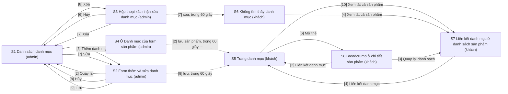

# Design: Danh mục sản phẩm

> **Epic:** SHOP-81 · **Jira:** https://phunghuutung12b4.atlassian.net/browse/SHOP-81 · **Spec:** docs/specs/SHOP-81/spec.md · **Status:** Draft
>
> **Figma version:** none

## Screens

| Code | Name | Route | User story | Kind | App |
|---|---|---|---|---|---|
| S1 | Danh sách danh mục (admin) | `/categories` | US1 Quản trị viên quản lý danh mục | ASCII | admin |
| S2 | Form thêm và sửa danh mục (admin) | `/categories/new`, `/categories/:categoryId/edit` | US1 Quản trị viên quản lý danh mục | ASCII | admin |
| S3 | Hộp thoại xác nhận xóa danh mục (admin) | `/categories`, hộp thoại mở trên S1 | US1 Quản trị viên quản lý danh mục | ASCII | admin |
| S4 | Ô Danh mục của form sản phẩm (admin) | `/products/new`, `/products/:productId/edit` | US2 Quản trị viên chọn danh mục cho sản phẩm | ASCII | admin |
| S5 | Trang danh mục (khách) | `/[locale]/categories/[slug]` | US3 Khách xem trang danh mục | ASCII | user |
| S6 | Không tìm thấy danh mục (khách) | `/[locale]/categories/[slug]`, HTTP 404 | US3 Khách xem trang danh mục | ASCII | user |
| S7 | Liên kết danh mục ở danh sách sản phẩm (khách) | `/[locale]/products` | US3 Khách xem trang danh mục | ASCII | user |
| S8 | Breadcrumb ở chi tiết sản phẩm (khách) | `/[locale]/products/[slug]` | US4 Khách thấy danh mục trên trang chi tiết sản phẩm | ASCII | user |

Quyết định ngày 2026-11-21, khi bạn đồng ý cả 10 đề xuất của `ux`:

- **Không có ảnh, nên cả tám màn hình là ASCII.** Thư mục `.ai/design-inbox/SHOP-81/` không có, và không màu hay kích thước nào đọc từ ảnh. Các màn hình dựng trên design system mà SHOP-7 để lại ở `docs/design-system/admin.md` và `docs/design-system/user.md`: cùng thẻ kính, nút, ô nhập, bảng, hộp thoại, giao diện sáng và tối. Ảnh Figma hay mockup chỉ cần khi bạn muốn một bố cục khác với trang của SHOP-7; khi đó bỏ ảnh vào `.ai/design-inbox/SHOP-81/` và `ux` đổi màn hình đó thành Figma hay Image.
- **Danh sách của `admin` giữ gọn.** Bảng danh mục (S1.4) không có phân trang, ô tìm hay bộ lọc, và bảng sản phẩm của SHOP-7 (S1.6) không có thêm cột Danh mục: SPEC không đòi, và AC11 đã bỏ. Nếu danh mục nhiều lên thì thêm ở Epic sau.
- **S4, S7 và S8 thêm vào màn hình có sẵn của SHOP-7** (form sản phẩm S2, danh sách sản phẩm S4, chi tiết sản phẩm S5 của `docs/specs/SHOP-7/design.md`). Chúng chỉ vẽ phần đổi; phần còn lại ghi "không đổi" kèm mã khối của SHOP-7, như SHOP-7 S2.8. Khi viết "SHOP-7 S4.1", đó là khối của design SHOP-7, không phải S4 của file này.
- **S1 đến S3 và S4 là của `admin`**, thiết kế cho máy tính từ 1024 px như SHOP-7; **S5 đến S8 là của `user`**, từ 320 px, giao diện sáng và tối.
- **Không hiện ra màn hình, nên không có khối nào gắn với chúng:** nửa sau của AC3 và AC10 (gọi thẳng API), AC19 (sitemap), và phần thẻ `<title>`, meta, canonical, hreflang, JSON-LD của AC18, AC20 và AC21, do mục SEO của SPEC viết. AC11 đã bỏ. Chữ "trong vòng 60 giây" của AC5 đến AC9 là độ trễ giữa hai app (mũi tên đứt của Flow), không phải một khối.
- **Chữ của giao diện** viết ở YAML dưới đây, bản `vi` và bản `en`. Tên danh mục hiện nguyên như người nhập ở cả hai ngôn ngữ (SPEC, Scope: Out). Chữ không có trong SPEC (trạng thái trống, lỗi, đang tải, nhãn Hiện và Ẩn, gợi ý) do `ux` viết, và đổi chữ chỉ sửa file i18n.

## Flow

Mũi tên liền là thao tác của người dùng; mũi tên đứt là tác động giữa hai app: một thay đổi lưu ở `admin` hiện ở trang khách trong vòng 60 giây.



## Screen Details

### S1 · Danh sách danh mục (admin)

```text
S1 · Danh sách danh mục (admin) · desktop
+------------------------------------------------------------------------------------------+
| [1] Thanh điều hướng:  Trang chủ | Sản phẩm | Danh mục (đang chọn) | Giới thiệu          |
+------------------------------------------------------------------------------------------+
| [2] Danh mục                                                         [3] (Thêm danh mục) |
|                                                                                          |
| +--------------------------------------------------------------------------------------+ |
| | [4] Tên           Đường dẫn      Trạng thái    Số sản phẩm    Thao tác               | |
| +--------------------------------------------------------------------------------------+ |
| |     Áo            ao             [5] Hiện      [6] 3          [7] Sửa  [8] Xóa       | |
| |     Phụ kiện      phu-kien           Ẩn            0              Sửa     Xóa        | |
| +--------------------------------------------------------------------------------------+ |
|                                                                                          |
|         [10] Toast: "Đã thêm danh mục"                                                   |
+------------------------------------------------------------------------------------------+
```

```text
S1 · Danh sách danh mục (admin) · desktop, chưa có danh mục
+------------------------------------------------------------------------------------------+
| [1] Thanh điều hướng:  Trang chủ | Sản phẩm | Danh mục (đang chọn) | Giới thiệu          |
+------------------------------------------------------------------------------------------+
| [2] Danh mục                                                         [3] (Thêm danh mục) |
|                                                                                          |
| +--------------------------------------------------------------------------------------+ |
| |                                                                                      | |
| |                [9] Chưa có danh mục nào.                                             | |
| |                                                                                      | |
| +--------------------------------------------------------------------------------------+ |
+------------------------------------------------------------------------------------------+
```

```yaml
screen: S1
route: /categories
blocks:
  1:
    name: Thanh điều hướng
    type: nav
    content: "Như SHOP-7 S1.1: ba viên thuốc (tên app, điều hướng, tiện ích). Thêm mục Danh mục (en “Categories”) giữa Sản phẩm và Giới thiệu; mục Danh mục đang chọn ở S1, S2 và S3"
    behavior: "`admin` thiết kế cho máy tính, từ 1024 px (SPEC: quản trị viên dùng trên máy tính), như SHOP-7; không có bố cục điện thoại"
    a11y: "`<nav>` có nhãn “Điều hướng chính”; mục đang chọn có aria-current=page"
  2:
    name: Tiêu đề trang
    type: heading
    content:
      vi: "Danh mục"
      en: "Categories"
    a11y: Là h1 duy nhất của trang
  3:
    name: Nút Thêm danh mục
    type: button
    content:
      vi: "Thêm danh mục"
      en: "Add category"
    behavior: Nút chính ở góc phải của hàng tiêu đề, như SHOP-7 S1.3. Sang S2 ở chế độ thêm
    ac: [AC2]
  4:
    name: Bảng danh mục
    type: table
    content: "Trong một thẻ kính, như SHOP-7 S1.6. Cột: Tên (14/600), Đường dẫn (slug, chữ muted), Trạng thái, Số sản phẩm (căn phải), Thao tác (căn phải). Dòng cao 64 như bảng sản phẩm, nhưng không có ô giữ chỗ 40 px vì danh mục không có ảnh. Thứ tự theo tên A→Z theo cách xếp chữ tiếng Việt, không phân biệt chữ hoa, chữ thường: `api` trả sẵn đúng thứ tự, `admin` không xếp lại. Bảng không có ô tìm, bộ lọc, nút sắp xếp hay phân trang: danh mục một cấp và `api` trả cả danh sách. Dưới 1024 px bảng cuộn ngang trong thẻ của nó"
    states:
      loading: 6 dòng khung xương, vùng aria-busy=true
      error: "Dòng thông báo “Không tải được danh sách danh mục.” (en “Couldn't load the categories.”) kèm nút phụ “Thử lại” (en “Try again”), role=alert"
      hover: Nền dòng đổi sang surface-2
    a11y: "`<table>` có `<caption>` ẩn “Danh sách danh mục”, tiêu đề cột `<th scope=col>`; vùng cuộn có tabindex=0 và nhãn “Danh sách danh mục”"
    ac: [AC1]
  5:
    name: Huy hiệu Trạng thái
    type: text
    content:
      vi: "Hiện hoặc Ẩn"
      en: "Visible or Hidden"
    behavior: "Hiện dùng sắc info (xanh dương), Ẩn dùng sắc neutral (xám), như Đang bán và Ẩn của sản phẩm. Danh mục Ẩn vẫn có trong bảng, với nhãn Ẩn (AC6)"
    a11y: Luôn có chấm và chữ, không dựa vào màu
    ac: [AC1, AC6]
  6:
    name: Số sản phẩm
    type: text
    content: "Số nguyên căn phải, như “3” hay “0”: số sản phẩm của danh mục, gồm cả sản phẩm Đang bán lẫn Ẩn. Hiện theo `Intl` của ngôn ngữ đang dùng. Khách không thấy số này (SPEC, Category Rules)"
    a11y: "Tiêu đề cột “Số sản phẩm” (en “Products”) gắn với ô bằng scope của `<th>`"
    ac: [AC1]
  7:
    name: Nút Sửa của dòng
    type: link
    content:
      vi: "Sửa"
      en: "Edit"
    behavior: Nút phụ nhỏ ở cuối dòng. Sang S2 ở chế độ sửa, cho danh mục của dòng
    a11y: "aria-label “Sửa Áo”: có tên danh mục"
  8:
    name: Nút Xóa của dòng
    type: button
    content:
      vi: "Xóa"
      en: "Delete"
    behavior: Nút phụ nhỏ, chữ màu bad, như SHOP-7 S1.8. Mở S3 cho danh mục của dòng, kể cả danh mục còn sản phẩm. Khi S3 đóng mà không xóa, focus về nút này
    a11y: "aria-label “Xóa Áo”: có tên danh mục"
    ac: [AC7, AC8]
  9:
    name: Thông báo chưa có danh mục
    type: text
    content:
      vi: "Chưa có danh mục nào."
      en: "No categories yet."
    behavior: "Thay phần thân bảng, ngay trong thẻ của bảng. Không có nút thứ hai: nút Thêm danh mục [3] vẫn ở góc phải, để một trang không có hai nút cùng tên"
    a11y: role=status
    ac: [AC1]
  10:
    name: Thông báo kết quả
    type: toast
    content:
      vi: "“Đã thêm danh mục”, “Đã lưu danh mục”, “Đã xóa danh mục”"
      en: "“Category added”, “Category saved”, “Category deleted”"
    behavior: "Hiện ở đáy giữa màn hình sau khi S2 lưu xong hoặc S3 xóa xong, như SHOP-7 S1.12. Chữ “Đã lưu danh mục” do ux đề xuất, SPEC không nêu chữ"
    a11y: "role=status; ở lại 6 giây, dừng khi rê chuột hay có focus, có nút đóng"
    ac: [AC2, AC7, AC8]
```

### S2 · Form thêm và sửa danh mục (admin)

```text
S2 · Form thêm và sửa danh mục (admin) · desktop
+----------------------------------------------------------------------------------+
| [1] Thanh điều hướng:  Trang chủ | Sản phẩm | Danh mục (đang chọn) | Giới thiệu  |
+----------------------------------------------------------------------------------+
| [2] < Danh mục                                                                   |
| +------------------------------------------------------------------------+       |
| | [3] Thêm danh mục                                                      |       |
| |     Khách chỉ thấy danh mục ở trạng thái Hiện.                         |       |
| |                                                                        |       |
| | [4] Thông báo của form (xung đột, lỗi chung; ẩn khi không có)          |       |
| |                                                                        |       |
| | Tên danh mục *                                                         |       |
| | [5] [___________________________________________]  0/60                |       |
| |     Dòng lỗi dưới ô, khi có                                            |       |
| |                                                                        |       |
| | Đường dẫn (slug)                                                       |       |
| | [6] /categories/ [__________________________]                          |       |
| |     Tự sinh từ tên. Nếu đã có, hệ thống thêm -2, -3...                 |       |
| |                                                                        |       |
| | Trạng thái                                                             |       |
| | [7] (Hiện) ( Ẩn )                                                      |       |
| |                                                                        |       |
| |                                     [8] (Hủy)  [9] (Thêm danh mục)     |       |
| +------------------------------------------------------------------------+       |
+----------------------------------------------------------------------------------+
```

```yaml
screen: S2
route: "/categories/new (thêm) và /categories/:categoryId/edit (sửa)"
blocks:
  1:
    name: Thanh điều hướng
    type: nav
    content: Như S1.1, mục Danh mục đang chọn
  2:
    name: Liên kết Quay lại danh sách
    type: link
    content:
      vi: "← Danh mục"
      en: "← Categories"
    behavior: Về S1, không lưu
  3:
    name: Tiêu đề form
    type: heading
    content:
      vi: "Thêm danh mục / Sửa danh mục; dòng phụ “Khách chỉ thấy danh mục ở trạng thái Hiện.”"
      en: "Add category / Edit category; subtitle “Customers only see categories that are Visible.”"
    behavior: "Thẻ kính rộng tối đa 640 px, căn giữa, như SHOP-7 S2.4; các ô xếp một cột, cách 16 px; Hủy và Lưu căn phải ở cuối thẻ. Form chỉ có ba trường: không có mô tả hay ảnh (SPEC, Scope: Out)"
    states:
      loading: "Chế độ sửa: khung xương cho tiêu đề và các ô trong lúc tải danh mục"
      not-found: "Chế độ sửa, mã không có hay danh mục đã bị xóa: thay form bằng “Không tìm thấy danh mục này. Có thể nó đã bị xóa.” (en “We couldn't find this category. It may have been deleted.”) và liên kết “Về danh sách danh mục” (en “Back to categories”) về S1"
      load-failed: "Chế độ sửa, `api` lỗi: thay form bằng “Không tải được danh mục.” (en “Couldn't load the category.”) và nút phụ “Thử lại”, role=alert"
    a11y: Là h1 duy nhất của trang; dòng phụ nằm ngay dưới
  4:
    name: Thông báo của form
    type: text
    content:
      vi: "Xung đột: “Danh mục vừa được sửa ở nơi khác. Tải lại để xem bản mới nhất.” kèm nút phụ “Tải lại”. Lỗi chung: “Không lưu được. Vui lòng thử lại.”"
      en: "Conflict: “This category was just edited elsewhere. Reload to see the latest version.” with the secondary button “Reload”. General error: “Couldn't save. Please try again.”"
    behavior: "Banner trên đầu form, ẩn khi không có gì, như SHOP-7 S2.5. Xung đột (`api` trả 409 theo `version`): lần lưu bị từ chối, không ghi đè bản của tab kia, mọi thứ đã nhập còn nguyên; chỉ nút Tải lại mới nạp lại trang. Lỗi chung: giữ nguyên dữ liệu, nút Lưu bấm lại được. Danh mục đã bị xóa ở tab khác lúc đang sửa (`api` trả 404): thay form bằng câu “Không tìm thấy danh mục này” của [3]"
    a11y: role=alert, focus không bị kéo đi
  5:
    name: Ô Tên danh mục
    type: input
    content:
      vi: "Nhãn “Tên danh mục”, placeholder “vd. Áo khoác”, bộ đếm “n/60”"
      en: "Label “Category name”, placeholder “e.g. Jackets”, counter “n/60”"
    validation: "Bắt buộc. Bỏ khoảng trắng đầu và cuối rồi dài 1–60 ký tự (bộ đếm tính theo độ dài đã bỏ khoảng trắng). Lỗi trống hay chỉ có khoảng trắng: “Nhập tên danh mục” (en “Enter a category name”). Lỗi dài: “Tên tối đa 60 ký tự” (en “Name must be 60 characters or fewer”). Trùng tên với danh mục khác, không phân biệt chữ hoa, chữ thường, do `api` trả 409 khi lưu: “Tên danh mục này đã có” (en “This category name already exists”), ngay dưới ô, không lưu, focus về ô này; form không kiểm trùng tên khi đang gõ"
    a11y: "Nhãn gắn với ô, required; lỗi gắn bằng aria-describedby và aria-invalid; khi lưu lỗi, focus về ô sai đầu tiên"
    ac: [AC2, AC3, AC4]
  6:
    name: Ô Slug
    type: input
    content:
      vi: "Nhãn “Đường dẫn (slug)”, phần đầu cố định “/categories/”"
      en: "Label “URL slug”, fixed prefix “/categories/”"
    behavior: "Thêm: ô tự điền từ tên khi gõ tên (`Áo khoác nữ` ra `ao-khoac-nu`) cho tới khi quản trị viên tự sửa ô; khi chưa sửa tay có dòng gợi ý “Tự sinh từ tên. Nếu đã có, hệ thống thêm -2, -3…” (en “Generated from the name. If taken, -2, -3… is added.”) và form để `api` tự sinh slug, nên slug lưu có thể là `ao-thun-2`. Sửa: không đổi theo tên, hiện slug đã lưu, kèm gợi ý “Đổi tên không đổi đường dẫn.” (en “Renaming doesn't change the link.”)"
    validation: "Chữ thường a–z, số và dấu gạch ngang đơn; không bắt đầu hay kết thúc bằng gạch ngang; tối đa 100 ký tự. Lỗi định dạng, như chữ hoa, dấu, khoảng trắng hay gạch ngang ở đầu: “Chỉ dùng chữ thường a–z, số và dấu gạch ngang; không bắt đầu hay kết thúc bằng dấu gạch ngang.” (en “Use lowercase a–z, digits and hyphens only, with no hyphen at the start or end.”). Lỗi dài: “Slug tối đa 100 ký tự” (en “Slug must be 100 characters or fewer”). Trùng slug tự gõ (`api` trả 409): “Slug này đã được dùng” (en “This slug is already in use”), ngay dưới ô, không lưu. Slug để trống (tự sinh) mà mọi slug sinh từ tên đều đã có: “Các slug tự sinh từ tên này đều đã được dùng. Hãy tự nhập một slug.” (en “Every slug made from this name is taken. Type a slug yourself.”), ngay dưới ô, focus về ô Slug. Cùng chữ và cách xử lý với SHOP-7 S2.7"
    states:
      slug-changed: "Chế độ sửa, slug khác slug đã lưu: dòng cảnh báo ngay dưới ô, màu warn kèm biểu tượng, “Đường dẫn cũ /categories/ao sẽ không mở được nữa.” (en “The old link /categories/ao will stop working.”). Hiện ngay khi gõ, trước khi lưu; mất đi khi gõ lại slug cũ. Đường dẫn cũ trả 404 ở cả /vi và /en sau khi lưu"
    a11y: "Cảnh báo role=status; lỗi như [5]"
    ac: [AC2, AC3, AC4, AC5]
  7:
    name: Chọn Trạng thái
    type: input
    content:
      vi: "Nhóm “Trạng thái”: Hiện, Ẩn; gợi ý “Ẩn: khách không thấy danh mục và trang của nó trả 404. Sản phẩm trong danh mục vẫn bán như cũ.”"
      en: "Group “Status”: Visible, Hidden; hint “Hidden: customers can't see the category and its page returns 404. Its products stay on sale.”"
    behavior: Hai lựa chọn dạng nút phân đoạn, như SHOP-7 S2.11. Thêm danh mục mới mặc định Hiện
    a11y: "`<fieldset>` và `<legend>`, là nhóm radio; mũi tên đổi lựa chọn"
    ac: [AC2, AC6]
  8:
    name: Nút Hủy
    type: button
    content:
      vi: "Hủy"
      en: "Cancel"
    behavior: Nút phụ. Về S1, bỏ những gì đã nhập, không lưu
  9:
    name: Nút Lưu
    type: button
    content:
      vi: "Thêm danh mục (chế độ thêm), Lưu thay đổi (chế độ sửa)"
      en: "Add category (add mode), Save changes (edit mode)"
    behavior: "Nút chính, như SHOP-7 S2.14. Kiểm cả form: có lỗi thì không gửi, hiện lỗi dưới từng ô sai, giữ nguyên những gì đã nhập, focus về ô sai đầu tiên. Hợp lệ thì gửi; thành công về S1 và hiện S1.10. Nút luôn bấm được, trừ lúc đang lưu, vì AC3 cần hiện lỗi ở từng ô sau khi lưu"
    states:
      api-invalid: "`api` trả 400 nêu trường sai mà form không tự bắt được: dưới mỗi trường đó (Tên, Slug) hiện “Giá trị này không hợp lệ.” (en “This value isn't valid.”), giữ nguyên những gì đã nhập, focus về trường đứng đầu theo thứ tự trên form. Một 400 không nêu trường nào, hay nêu Trạng thái, thì hiện lỗi chung ở [4]"
      saving: "Chữ “Đang lưu…” (en “Saving…”), khóa nút, aria-busy=true"
    ac: [AC2, AC3, AC4, AC5, AC6]
```

### S3 · Hộp thoại xác nhận xóa danh mục (admin)

```text
S3 · Hộp thoại xác nhận xóa danh mục (admin) · desktop
+----------------------------------------------------------------+
| [1] Xóa "Áo"?                                          [2] (X) |
|                                                                |
| [3] Việc xóa không hoàn tác được.                              |
| [4] 2 sản phẩm của danh mục này sẽ thành Không có danh mục.    |
| [5] Nếu chỉ muốn tạm ẩn danh mục, hãy chọn Ẩn khi sửa.         |
|                                                                |
|                                          [6] (Hủy)   [7] (Xóa) |
+----------------------------------------------------------------+
```

```text
S3 · Hộp thoại xác nhận xóa danh mục (admin) · desktop, danh mục không có sản phẩm
+----------------------------------------------------------------+
| [1] Xóa "Phụ kiện"?                                    [2] (X) |
|                                                                |
| [3] Việc xóa không hoàn tác được.                              |
| [5] Nếu chỉ muốn tạm ẩn danh mục, hãy chọn Ẩn khi sửa.         |
|                                                                |
|                                          [6] (Hủy)   [7] (Xóa) |
+----------------------------------------------------------------+
```

```yaml
screen: S3
route: "/categories, hộp thoại mở trên S1, không có đường dẫn riêng"
blocks:
  1:
    name: Tiêu đề hộp thoại
    type: heading
    content:
      vi: "Xóa “{tên danh mục}”?"
      en: "Delete “{category name}”?"
    behavior: "Hộp thoại kính như SHOP-7 S3, rộng tối đa 560 px, phía sau tối đi và mờ. Cùng một hộp thoại cho mọi danh mục; [4] chỉ hiện khi danh mục còn sản phẩm"
    a11y: "role=alertdialog, aria-modal=true, aria-labelledby là [1], aria-describedby là [3], [4] và [5]. Mở: focus vào [6], an toàn hơn [7]. Tab xoay trong hộp thoại, Esc như Hủy, phần phía sau không nhận focus. Đóng: focus về S1.8 của dòng"
    ac: [AC7, AC8]
  2:
    name: Nút Đóng
    type: button
    content: Biểu tượng dấu nhân trong vòng tròn 40 px, góc phải trên, như SHOP-7 S3.2
    behavior: Như [6]
    a11y: "aria-label “Đóng” (en “Close”)"
  3:
    name: Cảnh báo không hoàn tác
    type: text
    content:
      vi: "Việc xóa không hoàn tác được."
      en: "This can't be undone."
    ac: [AC7, AC8]
  4:
    name: Cảnh báo sản phẩm của danh mục
    type: text
    content:
      vi: "“{n} sản phẩm của danh mục này sẽ thành Không có danh mục.”, như “2 sản phẩm của danh mục này sẽ thành Không có danh mục.” và, khi n là 1, “1 sản phẩm …”"
      en: "“{n} products in this category will become No category.”, such as “2 products in this category will become No category.”; for 1, “1 product in this category will become No category.”"
    behavior: "Chỉ hiện khi danh mục còn ít nhất một sản phẩm. n là số sản phẩm của danh mục ở S1.6, gồm cả sản phẩm Ẩn, đọc từ danh sách lúc tải trang và không đọc lại khi mở hộp thoại: nếu một quản trị viên khác vừa gán thêm sản phẩm, số có thể cũ, và việc xóa vẫn đúng vì không xóa sản phẩm nào. Toast sau khi xóa chỉ nói “Đã xóa danh mục”, không nêu số. Nền banner warn kèm biểu tượng, để câu nổi lên giữa các dòng chữ thường. Khi danh mục không có sản phẩm, [4] không có trong hộp thoại và [3] đứng ngay trên [5]"
    a11y: "Không có role riêng: hộp thoại đã đọc nó qua aria-describedby; không dựa vào màu của banner"
    ac: [AC8]
  5:
    name: Gợi ý chọn Ẩn
    type: text
    content:
      vi: "Nếu chỉ muốn tạm ẩn danh mục, hãy chọn Ẩn khi sửa."
      en: "To hide the category for now, set its status to Hidden when you edit it."
    ac: [AC7]
  6:
    name: Nút Hủy
    type: button
    content:
      vi: "Hủy"
      en: "Cancel"
    behavior: Nút phụ. Đóng hộp thoại, danh mục còn nguyên
    ac: [AC7]
  7:
    name: Nút Xóa
    type: button
    content:
      vi: "Xóa"
      en: "Delete"
    behavior: "Nút nguy hiểm (nền destructive). Xóa hẳn danh mục; sản phẩm của nó thành Không có danh mục và không đổi trường nào khác (AC8). Thành công thì đóng hộp thoại, S1 tải lại danh sách và hiện “Đã xóa danh mục”. Slug của danh mục dùng lại được. Danh mục đã bị xóa ở tab khác (`api` trả 404): coi như đã xóa, cùng kết quả"
    states:
      deleting: "Chữ “Đang xóa…” (en “Deleting…”), khóa [2], [6] và [7]"
      error: "Giữ hộp thoại, hiện trên hàng nút “Không xóa được. Vui lòng thử lại.” (en “Couldn't delete. Please try again.”), role=alert"
    ac: [AC7, AC8]
```

### S4 · Ô Danh mục của form sản phẩm (admin)

```text
S4 · Ô Danh mục của form sản phẩm (admin) · desktop
+------------------------------------------------------------------------------+
| Form thêm và sửa sản phẩm, thẻ rộng tối đa 640 px (SHOP-7 S2)                |
| +------------------------------------------------------------------------+   |
| | [1] Ô Tên sản phẩm và ô Slug (không đổi, SHOP-7 S2.6 và S2.7)          |   |
| |                                                                        |   |
| | Danh mục                                                               |   |
| | [2] [Không có danh mục                                  v]             |   |
| |     Chọn được cả danh mục Ẩn, để chuẩn bị sản phẩm trước.              |   |
| |     (dòng lỗi dưới ô, khi có)                                          |   |
| |                                                                        |   |
| | [3] Mô tả, giá, trạng thái, tình trạng, nút (SHOP-7 S2.8 đến S2.14)    |   |
| +------------------------------------------------------------------------+   |
+------------------------------------------------------------------------------+
```

```yaml
screen: S4
route: "/products/new (thêm) và /products/:productId/edit (sửa), cùng form với SHOP-7 S2"
blocks:
  1:
    name: Ô Tên sản phẩm và ô Slug
    type: text
    content: "Không đổi: SHOP-7 S2.6 (Tên sản phẩm) và S2.7 (Slug)"
  2:
    name: Ô chọn Danh mục
    type: input
    content:
      vi: "Nhãn “Danh mục” (không bắt buộc); lựa chọn đầu “Không có danh mục”, rồi mọi danh mục theo tên A→Z, danh mục Ẩn ghi “Phụ kiện (Ẩn)”; gợi ý “Chọn được cả danh mục Ẩn, để chuẩn bị sản phẩm trước khi cho hiện danh mục.”"
      en: "Label “Category” (optional); first option “No category”, then every category by name A→Z, a Hidden one written “Accessories (Hidden)”; hint “Hidden categories can be picked too, to prepare products before the category goes live.”"
    behavior: "`<select>` gốc, rộng cả hàng, đặt giữa ô Slug và ô Mô tả. Thêm sản phẩm: mặc định “Không có danh mục”. Sửa: hiện danh mục đã lưu của sản phẩm, hay “Không có danh mục” nếu chưa có; chọn “Không có danh mục” rồi lưu thì sản phẩm bỏ khỏi danh mục, và mở lại form vẫn thấy “Không có danh mục”. Danh sách lựa chọn đọc từ `api` của quản trị, gồm cả danh mục Ẩn, và có “(Ẩn)” bằng chữ, không bằng màu. Lưu thành công về SHOP-7 S1 như cũ; số sản phẩm của danh mục ở S1.6 tăng hay giảm tương ứng"
    validation: "Danh mục đã bị xóa ở tab khác lúc form đang mở: lưu bị từ chối, sản phẩm không được lưu, những gì đã nhập còn nguyên, và dưới ô hiện “Danh mục này không còn. Hãy chọn danh mục khác.” (en “This category no longer exists. Pick another one.”), focus về ô này. Cùng chữ khi `api` trả 400 nêu trường danh mục. Sau lỗi, danh sách lựa chọn đọc lại để danh mục đã xóa không còn trong đó, ô về “Không có danh mục”, và lỗi ở lại cho tới khi quản trị viên chọn lại, kể cả chọn lại “Không có danh mục”"
    states:
      loading: "Ô khóa, hiện “Đang tải danh mục…” (en “Loading categories…”), aria-busy=true; nút Lưu của form khóa bằng aria-disabled tới khi có danh sách"
      error: "`api` lỗi: ô khóa, dòng lỗi “Không tải được danh mục.” (en “Couldn't load the categories.”) kèm nút phụ “Thử lại” (en “Try again”), role=alert; nút Lưu của form khóa như lúc tải, vì form không gửi được danh mục mà nó chưa biết"
    a11y: "`<select>` gốc có nhãn nhìn thấy; lỗi gắn bằng aria-describedby và aria-invalid; “(Ẩn)” là một phần của chữ lựa chọn nên trình đọc màn hình đọc ra"
    ac: [AC9, AC10]
  3:
    name: Các ô còn lại và nút của form
    type: text
    content: "Không đổi: SHOP-7 S2.8 (Mô tả) tới S2.14 (Lưu): mô tả, giá bán, giá gốc, trạng thái, tình trạng, Hủy, Lưu"
```

### S5 · Trang danh mục (khách)

```text
S5 · Trang danh mục (khách) · desktop
+----------------------------------------------------------------------------------------------+
| [1] Thanh điều hướng                                                                         |
+----------------------------------------------------------------------------------------------+
| [2] Trang chủ > Áo                                                                           |
| [3] Áo                                                                                       |
|                                                     Sắp xếp  [4] [Mới nhất                v] |
|                                                                                              |
| [5] Lưới sản phẩm: 24 thẻ mỗi lần, 3 cột từ 1024 px                                          |
| +--------------------------+    +--------------------------+    +--------------------------+ |
| | [6] Ô màu 4:3, chữ Á     |    | Ô màu 4:3, chữ Á         |    | Ô màu 4:3, chữ Á         | |
| | Áo thun cổ tròn          |    | Áo len                   |    | Áo sơ mi trắng           | |
| | 1.250.000 ₫              |    | 690.000 ₫                |    | 450.000 ₫                | |
| +--------------------------+    +--------------------------+    +--------------------------+ |
|                                                                                              |
|                           [7] Đã xem 24 trên 30 sản phẩm                                     |
|                                   [8] (Xem thêm)                                             |
+----------------------------------------------------------------------------------------------+
| [11] Chân trang                                                                              |
+----------------------------------------------------------------------------------------------+
```

```text
S5 · Trang danh mục (khách) · desktop, chưa có sản phẩm Đang bán
+----------------------------------------------------------------------------------------------+
| [1] Thanh điều hướng                                                                         |
+----------------------------------------------------------------------------------------------+
| [2] Trang chủ > Phụ kiện                                                                     |
| [3] Phụ kiện                                                                                 |
|                                                                                              |
|        [9] Chưa có sản phẩm nào trong danh mục này.                                          |
|        [10] Xem tất cả sản phẩm                                                              |
|                                                                                              |
+----------------------------------------------------------------------------------------------+
| [11] Chân trang                                                                              |
+----------------------------------------------------------------------------------------------+
```

```text
S5 · Trang danh mục (khách) · mobile
+----------------------------------+
| [1] Thanh điều hướng (2 hàng)    |
+----------------------------------+
| [2] Trang chủ > Áo               |
| [3] Áo                           |
| Sắp xếp                          |
| [4] [Mới nhất                 v] |
| [5] Lưới một cột                 |
| +------------------------------+ |
| | [6] Ô màu 4:3, chữ Á         | |
| | Áo thun cổ tròn              | |
| | 1.250.000 ₫                  | |
| +------------------------------+ |
| [7] Đã xem 24 trên 30 sản phẩm   |
|         [8] (Xem thêm)           |
+----------------------------------+
| [11] Chân trang                  |
+----------------------------------+
```

```yaml
screen: S5
route: "/[locale]/categories/[slug], locale là vi hoặc en"
blocks:
  1:
    name: Thanh điều hướng
    type: nav
    content: "Như SHOP-7 S4.1. Mục Sản phẩm đang chọn, như ở trang chi tiết sản phẩm: danh mục là một phần của cửa hàng sản phẩm; thanh điều hướng của `user` không có mục Danh mục"
    behavior: "Đổi ngôn ngữ ở đây giữ nguyên slug: `/vi/categories/ao` sang `/en/categories/ao`. Dưới 768 px thanh có hai hàng, như SHOP-7 S4.1"
    a11y: "`<nav>` có nhãn “Điều hướng chính”; mục đang chọn có aria-current=page"
  2:
    name: Breadcrumb
    type: nav
    content:
      vi: "Trang chủ › Áo"
      en: "Home › Áo"
    behavior: "Hai mục: “Trang chủ” (en “Home”) là liên kết về trang chủ `/[locale]`; tên danh mục là chữ, không phải liên kết. Dựng từ cùng danh sách mục với JSON-LD `BreadcrumbList`, để hai bên không lệch nhau. Chữ 13,5/600; liên kết màu `--primary-text`, mục cuối `--muted-foreground`; dấu › màu `--hint`; một hàng, xuống dòng khi hẹp, từ dài không tràn (overflow-wrap: anywhere); mục tiêu bấm của liên kết cao ít nhất 24 px (WCAG 2.5.8). Ở 320 px không có thanh cuộn ngang"
    a11y: "`<nav aria-label=\"Đường dẫn trang\">` (en “Breadcrumb”) chứa `<ol>`; mục cuối có aria-current=page; dấu › là `aria-hidden`, để trình đọc màn hình không đọc nó"
    ac: [AC18]
  3:
    name: Tiêu đề trang
    type: heading
    content: "Tên danh mục, như “Áo”, nguyên như người nhập, ở cả vi và en"
    behavior: "Cỡ h1 của design system của `user` (38/39,5; 28 dưới 768 px). Tên dài tới 60 ký tự xuống dòng, không tràn (overflow-wrap: anywhere). H1 là tên danh mục, không thêm tiền tố hay hậu tố. Nếu mục SEO của SPEC ghi chữ khác cho một ngôn ngữ, S5.3 sửa theo mục SEO"
    a11y: Là h1 duy nhất của trang
    ac: [AC12, AC15, AC18]
  4:
    name: Chọn sắp xếp
    type: input
    content:
      vi: "Nhãn “Sắp xếp”; lựa chọn Mới nhất, Giá thấp đến cao, Giá cao đến thấp"
      en: "Label “Sort by”; options Newest, Price: low to high, Price: high to low"
    behavior: "Ô chọn (select) như SHOP-7 S4.4, nhưng không có “Liên quan nhất” vì trang không có ô tìm, và không có ô tìm bên trái: ô chọn nằm bên phải hàng, nhãn nhìn thấy bên trái ô. Dưới 768 px ô chọn rộng hết hàng. Mặc định Mới nhất. Đổi là áp dụng ngay, không có nút Áp dụng; đổi `?sort=` (newest, price-asc, price-desc) và về 24 sản phẩm đầu. Giá trị sai trên đường dẫn trở về Mới nhất, không báo lỗi. Ẩn khi danh mục chưa có sản phẩm Đang bán (S5.9)"
    a11y: Là `<select>` gốc có nhãn nhìn thấy
    ac: [AC13, AC14]
  5:
    name: Lưới sản phẩm
    type: list
    content: "Chỉ có sản phẩm Đang bán của danh mục này, mới nhất trước theo mặc định; sản phẩm Ẩn, sản phẩm của danh mục khác và sản phẩm không có danh mục không có ở đây. Lưới như SHOP-7 S4.5: cột 1 dưới 640 px, 2 từ 640, 3 từ 1024, 4 từ 1440; khoảng cách 16 px; 24 thẻ mỗi lần tải. Hai sản phẩm bằng giá thì sản phẩm mới hơn đứng trước. Ở 320 px không có thanh cuộn ngang"
    states:
      loading: "8 thẻ khung xương, vùng aria-busy=true; breadcrumb và tiêu đề chờ có tên danh mục"
      error: "`api` lỗi: trang lỗi có sẵn của app “Đã xảy ra lỗi” kèm nút “Thử lại”, mã HTTP 5xx. Không bao giờ là 404 hay trang trống, để khách không tưởng danh mục không còn"
    a11y: "`<ul>` có nhãn “Danh sách sản phẩm”, mỗi thẻ là một `<li>`"
    ac: [AC12, AC13]
  6:
    name: Thẻ sản phẩm
    type: link
    content: "Như SHOP-7 S4.6, không đổi: ô giữ chỗ 4:3 với chữ cái đầu của tên, tên tối đa 2 dòng, giá bán, giá gốc gạch ngang kèm “-16%” khi có, huy hiệu Hết hàng khi hết hàng"
    behavior: Bấm thẻ mở trang chi tiết của sản phẩm (S8)
    a11y: Như SHOP-7 S4.6
    ac: [AC12]
  7:
    name: Dòng tiến độ
    type: text
    content:
      vi: "Đã xem 24 trên 30 sản phẩm"
      en: "Viewed 24 of 30 products"
    behavior: Như SHOP-7 S4.9. Căn giữa ngay trên nút [8]. Cập nhật sau mỗi lần Xem thêm. Số 30 là số sản phẩm Đang bán của danh mục
    a11y: "role=status, aria-live=polite"
    ac: [AC14]
  8:
    name: Nút Xem thêm
    type: button
    content:
      vi: "Xem thêm"
      en: "Load more"
    behavior: "Như SHOP-7 S4.10. Tải 24 sản phẩm kế tiếp, nối bên dưới, giữ các sản phẩm đã xem; cập nhật `?page=` trong đường dẫn bằng replace, không thêm mục lịch sử; `?sort=` được giữ. Focus chuyển tới thẻ mới đầu tiên. Hết sản phẩm thì ẩn nút. Tải lại hay mở cùng đường dẫn ở tab khác thì thấy cùng kiểu sắp xếp và cùng các sản phẩm đã xem. Sau lần Xem thêm cuối cùng, 6 sản phẩm còn lại hiện nối bên dưới và dòng [7] đọc “Đã xem 30 trên 30 sản phẩm”"
    states:
      loading: "Chữ “Đang tải…” (en “Loading…”), khóa nút, aria-busy=true"
      error: "Dòng “Không tải thêm được. Vui lòng thử lại.” (en “Couldn't load more. Please try again.”) trên nút, role=alert; nút bấm lại được"
    ac: [AC14]
  9:
    name: Thông báo chưa có sản phẩm
    type: text
    content:
      vi: "Chưa có sản phẩm nào trong danh mục này."
      en: "No products in this category yet."
    behavior: "Thay [4], [5], [7] và [8], khi danh mục Hiện mà chưa có sản phẩm Đang bán nào. Trang vẫn mở được, mã HTTP 200, và vẫn có breadcrumb [2] và tiêu đề [3]; danh mục này không có trong liên kết danh mục (S7) và trong sitemap, nên khách chỉ tới đây bằng đường dẫn trực tiếp"
    a11y: role=status
    ac: [AC15]
  10:
    name: Liên kết Xem tất cả sản phẩm
    type: link
    content:
      vi: "Xem tất cả sản phẩm"
      en: "View all products"
    behavior: Chỉ hiện cùng [9]. Nút chính; về `/[locale]/products` không tham số (S7)
    ac: [AC15]
  11:
    name: Chân trang
    type: text
    content: Như SHOP-7 S4.11
```

### S6 · Không tìm thấy danh mục (khách)

```text
S6 · Không tìm thấy danh mục (khách) · desktop
+----------------------------------------------------------------------------+
| [1] Thanh điều hướng                                                       |
+----------------------------------------------------------------------------+
|                                                                            |
|    [2] Không tìm thấy danh mục                                             |
|    [3] Danh mục này không tồn tại hoặc không còn được hiển thị.            |
|    [4] (Xem tất cả sản phẩm)                                               |
|                                                                            |
+----------------------------------------------------------------------------+
| [5] Chân trang                                                             |
+----------------------------------------------------------------------------+
```

```yaml
screen: S6
route: "/[locale]/categories/[slug], HTTP 404"
blocks:
  1:
    name: Thanh điều hướng
    type: nav
    content: Như S5.1, mục Sản phẩm đang chọn
  2:
    name: Tiêu đề không tìm thấy
    type: heading
    content:
      vi: "Không tìm thấy danh mục"
      en: "Category not found"
    behavior: "Thẻ kính ở giữa trang, như SHOP-7 S6; không có breadcrumb. Cùng một trang cho slug chưa từng có, danh mục Ẩn và danh mục đã xóa, nên khách không biết danh mục Ẩn có tồn tại. Mã HTTP 404 cho cả hai ngôn ngữ. Bố cục ở điện thoại không đổi"
    a11y: Là h1 duy nhất của trang
    ac: [AC16]
  3:
    name: Dòng giải thích
    type: text
    content:
      vi: "Danh mục này không tồn tại hoặc không còn được hiển thị."
      en: "This category doesn't exist or is no longer available."
    behavior: "Một câu cho cả ba trường hợp: không nói danh mục đã bị ẩn hay đã bị xóa"
    ac: [AC16]
  4:
    name: Liên kết Xem tất cả sản phẩm
    type: link
    content:
      vi: "Xem tất cả sản phẩm"
      en: "View all products"
    behavior: Nút chính. Về `/[locale]/products` không tham số (S7)
    ac: [AC16]
  5:
    name: Chân trang
    type: text
    content: Như SHOP-7 S4.11
```

### S7 · Liên kết danh mục ở danh sách sản phẩm (khách)

```text
S7 · Liên kết danh mục ở danh sách sản phẩm (khách) · desktop
+----------------------------------------------------------------------------------------+
| [1] Thanh điều hướng                                                                   |
+----------------------------------------------------------------------------------------+
| [2] Sản phẩm                                                                           |
| [3] Danh mục:  [4] (Áo khoác)  (Bao tay)  (Quần)                                       |
|                                                                                        |
| [5] Ô tìm, chọn sắp xếp, lưới sản phẩm, Xem thêm (không đổi, SHOP-7 S4.3 đến S4.10)    |
+----------------------------------------------------------------------------------------+
| Chân trang (không đổi)                                                                 |
+----------------------------------------------------------------------------------------+
```

```text
S7 · Liên kết danh mục ở danh sách sản phẩm (khách) · mobile
+----------------------------------+
| [1] Thanh điều hướng (2 hàng)    |
+----------------------------------+
| [2] Sản phẩm                     |
| [3] Danh mục                     |
| [4] (Áo khoác)  (Bao tay)        |
|     (Quần dài nữ cao cấp)        |
| [5] Ô tìm, sắp xếp và lưới       |
|     (không đổi)                  |
+----------------------------------+
| Chân trang (không đổi)           |
+----------------------------------+
```

```yaml
screen: S7
route: "/[locale]/products, locale là vi hoặc en"
blocks:
  1:
    name: Thanh điều hướng
    type: nav
    content: Như SHOP-7 S4.1, mục Sản phẩm đang chọn
  2:
    name: Tiêu đề trang
    type: heading
    content: Như SHOP-7 S4.2
  3:
    name: Hàng liên kết danh mục
    type: nav
    content:
      vi: "Nhãn nhìn thấy “Danh mục”, rồi các liên kết [4]"
      en: "Visible label “Categories”, then the links [4]"
    behavior: "Nằm ngay dưới tiêu đề và trên hàng tìm và sắp xếp (SHOP-7 S4.3 và S4.4), cách tiêu đề 12 px và cách hàng tìm 18 px. Nhãn 13,5/600 màu `--muted-foreground`, cùng hàng với các liên kết từ 768 px; dưới 768 px nhãn đứng một hàng riêng trên các liên kết. Hiện ở mọi trạng thái của trang, kể cả khi đang tìm. Khi không có danh mục nào đủ điều kiện của [4], cả hàng ẩn đi, không để chỗ trống"
    a11y: "`<nav aria-label=\"Danh mục\">` (en “Categories”) chứa `<ul>`"
    ac: [AC17]
  4:
    name: Liên kết danh mục
    type: link
    content: "Tên danh mục, như “Áo khoác”, “Bao tay”. Chỉ danh mục Hiện và có ít nhất một sản phẩm Đang bán: danh mục Ẩn, danh mục chỉ có sản phẩm Ẩn và danh mục đã xóa không có ở đây. Không kèm số sản phẩm, vì số đó chỉ `admin` thấy"
    behavior: "Mỗi danh mục một nút phụ nhỏ (`.btn--secondary.btn--sm`, cao 34, bo 999), xếp theo tên A→Z theo cách xếp chữ tiếng Việt, do `api` trả sẵn đúng thứ tự. Các nút cách nhau 8 px và xuống dòng khi hẹp; tên dài xuống dòng trong nút, không tràn (overflow-wrap: anywhere); ở 320 px không có thanh cuộn ngang. Bấm mở S5 của danh mục, ở cùng ngôn ngữ (`/vi/categories/<slug>` hay `/en/categories/<slug>`), không tham số. Hiện đủ mọi danh mục đủ điều kiện, xuống dòng khi hẹp: không giới hạn số liên kết và không có nút “Xem thêm” cho hàng này"
    a11y: "Mỗi liên kết có tên là tên danh mục; focus-visible vòng `--ring` như các nút khác"
    ac: [AC17]
  5:
    name: Phần còn lại của danh sách sản phẩm
    type: text
    content: "Không đổi: SHOP-7 S4.3 (Ô tìm) tới S4.10 (Xem thêm), và chân trang S4.11"
```

### S8 · Breadcrumb ở chi tiết sản phẩm (khách)

```text
S8 · Breadcrumb ở chi tiết sản phẩm (khách) · desktop
+----------------------------------------------------------------------------------------+
| [1] Thanh điều hướng                                                                   |
+----------------------------------------------------------------------------------------+
| [2] Trang chủ > Áo > Áo thun cổ tròn                                                   |
| [3] < Sản phẩm                                                                         |
| +------------------------------------------------------------------------------------+ |
| | [4] Thẻ chi tiết: ảnh giữ chỗ, tên, giá, tình trạng, mô tả                         | |
| |     (không đổi, SHOP-7 S5.3 đến S5.10)                                             | |
| +------------------------------------------------------------------------------------+ |
+----------------------------------------------------------------------------------------+
| [5] Chân trang                                                                         |
+----------------------------------------------------------------------------------------+
```

```text
S8 · Breadcrumb ở chi tiết sản phẩm (khách) · mobile
+----------------------------------+
| [1] Thanh điều hướng (2 hàng)    |
+----------------------------------+
| [2] Trang chủ > Áo >             |
|     Áo thun cổ tròn dài tên      |
| [3] < Sản phẩm                   |
| +------------------------------+ |
| | [4] Thẻ chi tiết (không đổi) | |
| +------------------------------+ |
+----------------------------------+
| [5] Chân trang                   |
+----------------------------------+
```

```yaml
screen: S8
route: "/[locale]/products/[slug], locale là vi hoặc en"
blocks:
  1:
    name: Thanh điều hướng
    type: nav
    content: Như SHOP-7 S4.1, mục Sản phẩm đang chọn
  2:
    name: Breadcrumb
    type: nav
    content:
      vi: "Trang chủ › Áo › Áo thun cổ tròn"
      en: "Home › Áo › Áo thun cổ tròn"
    behavior: "Dựng từ cùng danh sách mục với JSON-LD `BreadcrumbList`. Ba mục khi sản phẩm thuộc một danh mục Hiện: “Trang chủ” (en “Home”) là liên kết về `/[locale]`; tên danh mục là liên kết tới `/[locale]/categories/<slug>` ở cùng ngôn ngữ (S5); tên sản phẩm là chữ, không phải liên kết. Kiểu chữ, màu, xuống dòng và mục tiêu bấm như S5.2; tên sản phẩm dài xuống dòng, không tràn (overflow-wrap: anywhere), và ở 320 px không có thanh cuộn ngang. Nằm trên liên kết quay lại [3], cách thẻ 16 px"
    states:
      no-category: "Sản phẩm không có danh mục, hay danh mục của nó Ẩn hay đã xóa: hai mục “Trang chủ › {tên sản phẩm}”. Không chỗ nào của trang, kể cả chữ ẩn và JSON-LD, nhắc tới danh mục đó"
    a11y: "Như S5.2: `<nav aria-label=\"Đường dẫn trang\">` (en “Breadcrumb”) chứa `<ol>`; mục cuối là tên sản phẩm có aria-current=page"
    ac: [AC20, AC21]
  3:
    name: Liên kết Quay lại danh sách
    type: link
    content:
      vi: "← Sản phẩm"
      en: "← Products"
    behavior: "Không đổi so với SHOP-7 S5.2: về `/[locale]/products` không tham số (S7). Liên kết được giữ và đặt ngay dưới breadcrumb [2]: SPEC chỉ thêm breadcrumb, breadcrumb không có mục “Sản phẩm”, và một E2E của SHOP-7 (“the back link opens the products page S4”) còn bấm vào liên kết này"
  4:
    name: Thẻ chi tiết sản phẩm
    type: card
    content: "Không đổi: SHOP-7 S5.3 (ảnh giữ chỗ) tới S5.10 (nội dung mô tả)"
  5:
    name: Chân trang
    type: text
    content: Như SHOP-7 S4.11
```

## Design System

**App:** admin (S1 đến S4) và user (S5 đến S8) · **Design system của app:** `docs/design-system/admin.md` và `docs/design-system/user.md`

Cả tám màn hình là ASCII, nên không có ảnh để đọc token. Epic này không thêm màu, font, khoảng cách, bo góc, bóng hay điểm ngắt: mọi màn hình dùng token và class có sẵn của hai file trên, ở giao diện sáng lẫn tối.

- **Dùng lại đúng như có:**
  - ở `admin`: viên thuốc điều hướng, nút chính, nút phụ, nút nguy hiểm, nút phân đoạn, ô nhập và ô chọn, nhãn trường, thẻ kính, bảng, huy hiệu trạng thái, banner, hộp thoại, toast, khung xương;
  - ở `user`: viên thuốc điều hướng, nút chính, nút phụ nhỏ, thẻ kính, ô chọn, thẻ sản phẩm, lưới, dòng tiến độ, nút Xem thêm, khung xương, chân trang, trang không tìm thấy.
- **Hai khối mới của `user`, dựng từ token có sẵn:** Breadcrumb (S5.2, S8.2: chữ `--fs-md` 600, `--primary-text`, `--muted-foreground`, `--hint`, khoảng cách `--space-2`) và Hàng liên kết danh mục (S7.3, S7.4: nhãn 13,5/600 và các nút `.btn--secondary.btn--sm`). Chúng không cần giá trị mới nào trong bảng token.
- **`admin` có thêm một mục điều hướng** (Danh mục, S1.1) và một cột "Số sản phẩm" căn phải trong bảng, đều dùng class của `.pill__link` và `.table__num` có sẵn.

Quyết định ngày 2026-11-21, khi bạn đồng ý đề xuất của `ux`: vì không có mục "mới" của bảng token, plan không đặt Task "Design system của <app>" riêng ở đầu, để giữ trong 3 item của SPEC. Story của `user` thêm Breadcrumb và Hàng liên kết danh mục vào `docs/design-system/user.md` trong cùng PR; `sa` ghi điều này vào plan.

## Open Questions

Không có. Ngày 2026-11-21 bạn đồng ý cả 10 đề xuất của `ux`, và mỗi câu trả lời đã thành quyết định ở mục của nó:

- H1 của trang danh mục: S5.3.
- Liên kết "← Sản phẩm" ở trang chi tiết: S8.3.
- Task design system: mục Design System.
- Số sản phẩm trong hộp thoại xóa: S3.4.
- Danh mục đã bị xóa ở tab khác: S2.3, S2.4 và S3.7.
- Ô Danh mục sau lỗi AC10 và khi không tải được: S4.2.
- Danh sách của `admin` giữ gọn: S1.4 và ghi chú dưới bảng Screens.
- Hàng liên kết danh mục của khách: S7.3 và S7.4.
- Chữ ngoài SPEC: ghi chú dưới bảng Screens, và YAML của từng khối.
- Màn hình chưa có ảnh: ghi chú dưới bảng Screens.
