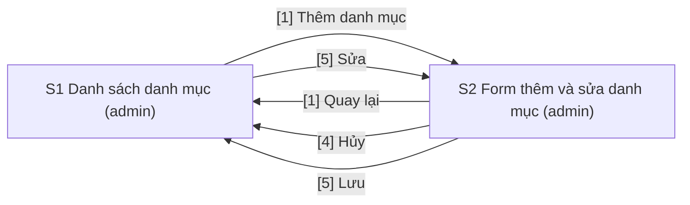

# Design: Thứ tự hiển thị danh mục

> **Epic:** SHOP-95 · **Jira:** https://phunghuutung12b4.atlassian.net/browse/SHOP-95 · **Spec:** docs/specs/SHOP-95/spec.md · **Status:** Draft
>
> **Figma version:** none

## Screens

| Code | Name | Route | User story | Kind | App |
|---|---|---|---|---|---|
| S1 | Danh sách danh mục (admin) | `/categories` | US1 Quản trị viên đặt thứ tự hiển thị của danh mục | ASCII | admin |
| S2 | Form thêm và sửa danh mục (admin) | `/categories/new`, `/categories/:categoryId/edit` | US1 Quản trị viên đặt thứ tự hiển thị của danh mục | ASCII | admin |

Quyết định ngày 2026-11-23, khi bạn đồng ý cả bốn đề xuất của `ux` (Claude chọn theo đề xuất, vì bạn đã giao cổng ① của Epic này cho Claude):

- **Không có ảnh, nên cả hai màn hình là ASCII.** Thư mục `.ai/design-inbox/SHOP-95/` không có, và không màu hay kích thước nào đọc từ ảnh. Hai màn hình dựng trên design system của `admin` ở `docs/design-system/admin.md`: cùng thẻ kính, bảng, ô nhập, nút, giao diện sáng và tối. Ảnh Figma hay mockup chỉ cần khi bạn muốn một bố cục khác với trang của SHOP-81; khi đó bỏ ảnh vào `.ai/design-inbox/SHOP-95/` và `ux` đổi màn hình đó thành Figma hay Image.
- **Chỉ hai màn hình, cả hai là của SHOP-81 có thêm một khối.** S1 là bảng danh mục (SHOP-81 S1) có thêm cột thứ tự, và S2 là form thêm và sửa danh mục (SHOP-81 S2) có thêm ô thứ tự. Khi viết "SHOP-81 S2.5", đó là khối của design SHOP-81, không phải S2 của file này. Chúng chỉ vẽ phần đổi; phần còn lại ghi "không đổi" kèm mã khối của SHOP-81.
- **Không có màn hình riêng cho phần còn lại của Epic**, vì chúng không đổi giao diện (SPEC, Objective):
  - AC4 gọi thẳng API, nên không hiện ra màn hình nào;
  - AC6: ô Danh mục của form sản phẩm (SHOP-81 S4.2) giữ nguyên chữ, lựa chọn "Không có danh mục" đầu tiên và nhãn "(Ẩn)"; chỉ thứ tự các lựa chọn đổi, do `api` trả sẵn;
  - AC7 và phần trang `/vi/products` của AC8: các liên kết danh mục của khách (SHOP-81 S7.4) chỉ đổi thứ tự.
- **Với `seo`:** cả S1 và S2 thuộc `admin`, mà `admin` có `seo: false` trong `project.yaml`, và Epic không có màn hình của `user`. Không màn hình nào của file này cần mục SEO.
- **Hai quyết định bố cục:**
  - Cột thứ tự đứng sau Số sản phẩm và trước Thao tác (S1.3, S1.4), để Tên vẫn là cột đầu và số sản phẩm vẫn là ô thứ 4 của dòng: `apps/admin/e2e/product-category.spec.ts` đọc số sản phẩm bằng `row.getByRole('cell').nth(3)`. Thêm cột nào cũng làm helper `expectCells` của `apps/admin/e2e/categories.spec.ts` fail, vì nó kiểm đúng 5 ô của dòng (8 lần gọi). Vì vậy item 2 thêm ô thứ tự vào `expectCells`, một chỗ sửa chung cho 8 lần gọi; `sa` ghi việc đó vào plan, và `ba` sửa câu trong SPEC thành "mọi E2E của SHOP-81 vẫn pass mà không sửa, trừ helper `expectCells`".
  - Ô thứ tự đứng cuối các ô của form, sau Trạng thái: nó phụ so với tên, slug và trạng thái, và thứ tự Tab, cùng việc đưa focus về "ô sai đầu tiên" của SHOP-81 S2.9, giữ nguyên cho ba ô có sẵn.
- **`admin` thiết kế cho máy tính, từ 1024 px**, như SHOP-81 và SHOP-7: không có bố cục điện thoại. Dưới 640 px form vẫn một cột như SHOP-81 S2.3.
- **Cách kiểm AC8 tách theo item.** Nửa "cả ba có thứ tự 0" của AC8 trên trang Danh mục của `admin` chỉ thấy được khi có cột S1.3 và S1.4, tức ở item 2, trong lúc item 1 (`be-dev`) chưa có cột. Vì vậy: item 1 kiểm số 0 qua `GET /api/admin/categories` và thứ tự theo tên ở `/vi/products`; item 2 kiểm cột hiện "0" ở S1.4. `sa` ghi cách chia này vào plan.
- **Số thứ tự hiện bằng chữ số thường, không có dấu phân cách hàng nghìn**, ở cột S1.4 và ô S2.3: 1000, không phải 1.000, vì quản trị viên gõ lại đúng số đó và "1.000" của tiếng Việt dễ đọc nhầm là số lẻ, trong lúc 1.5 là lỗi. Cột Số sản phẩm vẫn theo `Intl`.
- **Chữ của giao diện** viết ở YAML dưới đây, bản `vi` và bản `en`. SPEC không nêu chữ nào của ô và cột này: nhãn "Thứ tự hiển thị" (en "Display order"; không dùng "Order" vì dễ nhầm với đơn hàng), gợi ý, hai lỗi và tiêu đề cột do `ux` viết ở S1.3 và S2.3, và đổi chữ chỉ sửa `category.json` của hai ngôn ngữ.

## Flow

Mũi tên liền là thao tác của người dùng. Tác động của một thay đổi lên màn hình ngoài file này không vẽ ở đây, vì các màn hình đó không đổi: bảng danh mục và ô Danh mục của form sản phẩm ở `admin` hiện thứ tự mới ngay sau khi S2 lưu, và các liên kết danh mục của `user` (SHOP-81 S7.4) trong vòng 60 giây, như mọi thay đổi danh mục của SHOP-81.



## Screen Details

### S1 · Danh sách danh mục (admin)

```text
S1 · Danh sách danh mục (admin) · desktop
+------------------------------------------------------------------------------------------------+
| Thanh điều hướng và tiêu đề "Danh mục": không đổi (SHOP-81 S1.1, S1.2)     [1] (Thêm danh mục) |
|                                                                                                |
| +--------------------------------------------------------------------------------------------+ |
| | [2] Tên         Đường dẫn   Trạng thái   Số sản phẩm   [3] Thứ tự hiển thị        Thao tác | |
| +--------------------------------------------------------------------------------------------+ |
| |     Quần        quan        Hiện                   4                 [4] 0    [5] Sửa  Xóa | |
| |     Bao tay     bao-tay     Hiện                   2                     1        Sửa  Xóa | |
| |     Đầm         dam         Ẩn                     0                     1        Sửa  Xóa | |
| |     Áo          ao          Hiện                   3                     2        Sửa  Xóa | |
| +--------------------------------------------------------------------------------------------+ |
+------------------------------------------------------------------------------------------------+
```

```yaml
screen: S1
route: /categories
blocks:
  1:
    name: Nút Thêm danh mục
    type: button
    content:
      vi: "Thêm danh mục"
      en: "Add category"
    behavior: "Không đổi: SHOP-81 S1.3, nút chính ở góc phải của hàng tiêu đề. Sang S2 ở chế độ thêm, nơi ô thứ tự S2.3 điền sẵn 0"
    ac: [AC1]
  2:
    name: Bảng danh mục
    type: table
    content: "Trong một thẻ kính như SHOP-81 S1.4. Cột theo thứ tự: Tên, Đường dẫn, Trạng thái, Số sản phẩm (căn phải), Thứ tự hiển thị (căn phải, mới), Thao tác (căn phải). Năm cột có sẵn không đổi (SHOP-81 S1.4 đến S1.8): Sửa là [5], Xóa mở hộp thoại của SHOP-81 S3"
    behavior: "Dòng xếp theo số thứ tự tăng dần, cùng số thì theo tên A→Z (chữ tiếng Việt, không phân biệt chữ hoa, thường), cùng tên thì theo `id`: `api` trả sẵn đúng thứ tự, `admin` không xếp lại, như `CategoryRows` hiện nay. Danh mục Ẩn vẫn có trong bảng, đúng chỗ theo số của nó. Bảng vẫn không có ô tìm, bộ lọc, nút sắp xếp hay phân trang, và tiêu đề cột không bấm được để xếp lại bảng (SPEC, Scope: Out). Sau khi S2 lưu, S1 tải lại danh sách từ `api` và hiện thứ tự mới ngay (SPEC, Độ trễ). Dưới 1024 px bảng cuộn ngang trong thẻ của nó như SHOP-81 S1.4; thêm một cột không đổi quy tắc đó"
    states:
      loading: "6 dòng khung xương như SHOP-81 S1.4, mỗi dòng thêm một ô cho cột mới (6 ô), vùng aria-busy=true"
      empty: "“Chưa có danh mục nào.” (en “No categories yet.”) như SHOP-81 S1.9, trải hết 6 cột"
      error: "“Không tải được danh sách danh mục.” kèm nút “Thử lại”, như SHOP-81 S1.4"
    a11y: "Như SHOP-81 S1.4: `<table>` có `<caption>` ẩn “Danh sách danh mục”, vùng cuộn có tabindex=0 và nhãn “Danh sách danh mục”"
    ac: [AC5, AC8]
  3:
    name: Tiêu đề cột Thứ tự hiển thị
    type: text
    content:
      vi: "Thứ tự hiển thị"
      en: "Display order"
    behavior: "Cột mới, đứng sau Số sản phẩm và trước Thao tác, để số sản phẩm vẫn là ô thứ 4 của dòng; helper `expectCells` của E2E SHOP-81 thêm ô thứ tự. Căn phải như Số sản phẩm (class `.table__num`). Chữ tiêu đề cột 12/600 `--muted` như các cột khác. Không phải nút và không có mũi tên sắp xếp: bảng không xếp lại khi bấm (SPEC, Scope: Out)"
    a11y: "`<th scope=col>` như các cột khác, nên trình đọc màn hình đọc “Thứ tự hiển thị, 2” cho ô của dòng. Cùng chữ với nhãn của ô nhập S2.3"
    ac: [AC1, AC5]
  4:
    name: Ô thứ tự của dòng
    type: text
    content: "Số nguyên từ 0 tới 9999 của danh mục, như “0”, “1”, “2”: chữ số thường, không dấu phân cách hàng nghìn, ở cả vi và en (1000, không phải 1.000), vì quản trị viên gõ lại đúng số này ở S2.3 và “1.000” dễ đọc nhầm thành số lẻ ở tiếng Việt. Khác với cột Số sản phẩm, ô này không đi qua `Intl`"
    behavior: "Mọi dòng có số, kể cả danh mục chưa ai đặt: hiện “0”, không để trống hay gạch ngang (AC8). Phần của AC8 mà item 2 kiểm là cột này hiện “0”; số 0 và thứ tự theo tên của danh mục chưa đặt số kiểm ở item 1, qua `api` và `/vi/products`. Hai danh mục cùng số hiện cùng số và xếp theo tên (AC5: Bao tay và Đầm cùng 1). Chỉ `admin` thấy số này, khách không thấy (SPEC, Category Rules)"
    a11y: "Số là chữ thường của ô, không dựa vào màu hay biểu tượng"
    ac: [AC1, AC2, AC5, AC8]
  5:
    name: Nút Sửa của dòng
    type: link
    content:
      vi: "Sửa"
      en: "Edit"
    behavior: "Không đổi: SHOP-81 S1.7, aria-label “Sửa Áo” có tên danh mục. Sang S2 ở chế độ sửa, nơi ô thứ tự S2.3 hiện số đã lưu của danh mục"
    ac: [AC2]
```

### S2 · Form thêm và sửa danh mục (admin)

```text
S2 · Form thêm và sửa danh mục (admin) · desktop
+----------------------------------------------------------------------------------------+
| Thanh điều hướng: không đổi (SHOP-81 S2.1)                                             |
| [1] < Danh mục                                                                         |
|   +------------------------------------------------------------------------------+     |
|   | [2] Tiêu đề, thông báo của form, Tên, Slug và Trạng thái                     |     |
|   |     (không đổi, SHOP-81 S2.3 đến S2.7)                                       |     |
|   |                                                                              |     |
|   | Thứ tự hiển thị *                                                            |     |
|   | [3] [0_________________________________________________________]             |     |
|   |     Số nguyên từ 0 đến 9999. Số nhỏ hiện trước; cùng số thì xếp theo tên.    |     |
|   |     Dòng lỗi dưới ô, khi có                                                  |     |
|   |                                                                              |     |
|   |                                       [4] (Hủy)  [5] (Thêm danh mục)         |     |
|   +------------------------------------------------------------------------------+     |
+----------------------------------------------------------------------------------------+
```

```yaml
screen: S2
route: "/categories/new (thêm) và /categories/:categoryId/edit (sửa)"
blocks:
  1:
    name: Liên kết Quay lại danh sách
    type: link
    content:
      vi: "← Danh mục"
      en: "← Categories"
    behavior: "Không đổi: SHOP-81 S2.2. Về S1, không lưu"
  2:
    name: Các trường có sẵn của form
    type: text
    content: "Không đổi: SHOP-81 S2.3 (tiêu đề và các trạng thái tải, không tìm thấy, lỗi tải), S2.4 (thông báo của form: xung đột và lỗi chung), S2.5 (Tên danh mục), S2.6 (Slug) và S2.7 (Trạng thái)"
    behavior: "Thẻ kính rộng tối đa 640 px, các ô một cột cách 16 px, như SHOP-81 S2.3. Khi lưu lỗi, focus về ô sai đầu tiên theo thứ tự trên form: Tên, Slug, rồi [3]. Lỗi của [3] không làm hiện banner của SHOP-81 S2.4"
  3:
    name: Ô Thứ tự hiển thị
    type: input
    content:
      vi: "Nhãn “Thứ tự hiển thị”, dấu * (bắt buộc); gợi ý “Số nguyên từ 0 đến 9999. Số nhỏ hiện trước; cùng số thì xếp theo tên.”"
      en: "Label “Display order”, * (required); hint “A whole number from 0 to 9999. Lower numbers come first; the same number sorts by name.”"
    behavior: "Ô cuối các trường của form, sau Trạng thái. Thêm danh mục: điền sẵn 0. Sửa danh mục: điền số đã lưu của danh mục, viết bằng chữ số thường, như 3 hay 1000. Ô nhập chữ (`type=text`, `inputMode=numeric`, `autoComplete=off`), như ô giá của form sản phẩm, không phải `type=number`: trình duyệt không tự bỏ chữ “abc”, không có nút tăng giảm, và con lăn chuột không đổi số. Không đặt `maxLength`, để 10000 gõ được và báo lỗi. Rộng cả hàng như các ô khác của form, không prefix hay suffix, không class hay token mới. Khi lưu, form gửi số nguyên đã bỏ khoảng trắng đầu và cuối (“007” gửi 7). Ở chế độ sửa, ô đã điền số đã lưu, nên không sửa ô thì số vẫn như cũ"
    validation: "Bắt buộc, kiểm khi lưu, không kiểm khi đang gõ. Bỏ khoảng trắng đầu và cuối rồi phải chỉ gồm chữ số 0–9 và có giá trị từ 0 tới 9999: 0 và 9999 hợp lệ. Ô trống hay chỉ có khoảng trắng: “Nhập thứ tự hiển thị” (en “Enter a display order”), và không được hiểu là 0. Mọi giá trị sai khác, như -1, 10000, 1.5, 1,5 hay “abc”: “Thứ tự là số nguyên từ 0 đến 9999” (en “Display order must be a whole number from 0 to 9999”), và 1.5 không được làm tròn. Lỗi hiện ngay dưới ô, danh mục không được lưu, và những gì đã nhập còn nguyên"
    states:
      error: "aria-invalid=true, viền `--bad-text`, dòng lỗi có biểu tượng và chữ, như các ô khác của SHOP-81 S2"
      loading: "Chế độ sửa: một nhãn và một ô khung xương thêm vào khung xương của form (SHOP-81 S2.3) trong lúc tải danh mục"
      api-invalid: "`api` trả 400 nêu trường thứ tự mà form không tự bắt được: dưới ô hiện “Thứ tự là số nguyên từ 0 đến 9999”, giữ nguyên những gì đã nhập, focus về ô nếu nó là ô sai đầu tiên. Khác với Tên và Slug (“Giá trị này không hợp lệ.”), ô này có câu cụ thể, vì mọi giá trị sai của nó chung một lý do"
    a11y: "Nhãn gắn với ô bằng `htmlFor`, ô có `required`, dấu * là aria-hidden, như `InputField`. Lỗi và gợi ý gắn bằng aria-describedby, lỗi đứng trước; lỗi có aria-invalid, và không dựa vào màu vì có biểu tượng và chữ. Tab tới ô này sau Trạng thái và trước Hủy. Trên thiết bị cảm ứng, `inputMode=numeric` hiện bàn phím số"
    ac: [AC1, AC2, AC3]
  4:
    name: Nút Hủy
    type: button
    content:
      vi: "Hủy"
      en: "Cancel"
    behavior: "Không đổi: SHOP-81 S2.8, nút phụ. Về S1, bỏ những gì đã nhập, không lưu"
  5:
    name: Nút Lưu
    type: button
    content:
      vi: "Thêm danh mục (chế độ thêm), Lưu thay đổi (chế độ sửa)"
      en: "Add category (add mode), Save changes (edit mode)"
    behavior: "Như SHOP-81 S2.9, và kiểm thêm [3] cùng lượt với các ô khác: có lỗi thì không gửi, hiện lỗi dưới từng ô sai, giữ nguyên những gì đã nhập, focus về ô sai đầu tiên. Hợp lệ thì gửi tên, slug, trạng thái và số thứ tự; thành công về S1 và hiện “Đã thêm danh mục” (thêm) hay “Đã lưu danh mục” (sửa), như SHOP-81 S1.10; dòng của danh mục trong S1.2 hiện số vừa lưu, đúng chỗ của nó trong thứ tự mới. Chế độ sửa mà chỉ đổi số: tên, slug và trạng thái giữ nguyên. Nút luôn bấm được trừ lúc đang lưu, để AC3 hiện lỗi từng ô"
    states:
      saving: "Chữ “Đang lưu…” (en “Saving…”), khóa nút, aria-busy=true, như SHOP-81 S2.9"
    ac: [AC1, AC2, AC3]
```

## Design System

**App:** admin · **Design system của app:** docs/design-system/admin.md

Cả hai màn hình là ASCII, nên không có ảnh để đọc token. Epic này không thêm màu, font, khoảng cách, bo góc, bóng hay điểm ngắt: S1 và S2 dùng token và class có sẵn của `docs/design-system/admin.md`, ở giao diện sáng lẫn tối. Vì không có mục "mới", plan không cần Task "Design system của admin" ở đầu.

| Loại | Tên | Giá trị | Có hay mới |
|---|---|---|---|
| Component | Ô nhập có nhãn (`InputField`) | Ô Thứ tự hiển thị S2.3: nhãn, `required`, gợi ý, lỗi, không prefix hay suffix; `inputMode=numeric` | có |
| Component | Dòng gợi ý và dòng lỗi (`.field-hint`, `.field-error`) | Gợi ý của S2.3; lỗi 12,5/500 màu `--bad-text` kèm biểu tượng | có |
| Component | Bảng (`.table`, `.table__num`) | Thêm một cột căn phải ở S1.3 và S1.4, cùng class với cột Số sản phẩm | có |
| Component | Khung xương (`.skeleton`) | Thêm một ô ở mỗi dòng của bảng, thêm một nhãn và ô ở form sửa lúc tải | có |
| Màu, Font, Khoảng cách, Bo góc, Điểm ngắt | token của `tokens.css` | Không thêm giá trị nào | có |

## Open Questions

Không có. Ngày 2026-11-23 bạn đồng ý cả bốn đề xuất của `ux`, và mỗi câu trả lời đã thành quyết định ở mục của nó:

- Vị trí cột thứ tự và helper `expectCells` của E2E SHOP-81: ghi chú dưới bảng Screens ("Hai quyết định bố cục") và S1.3.
- Cách kiểm AC8 tách theo item: ghi chú dưới bảng Screens ("Cách kiểm AC8 tách theo item") và S1.4.
- Số thứ tự không có dấu phân cách hàng nghìn: ghi chú dưới bảng Screens, S1.4 và S2.3.
- Chữ ngoài SPEC của cột và ô thứ tự: ghi chú dưới bảng Screens, và YAML của S1.3 và S2.3.
