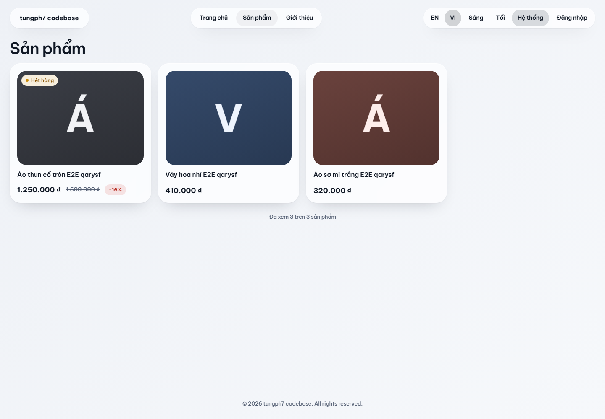
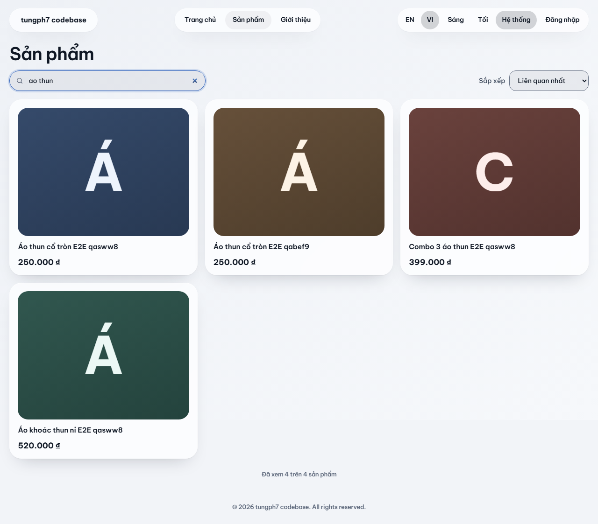
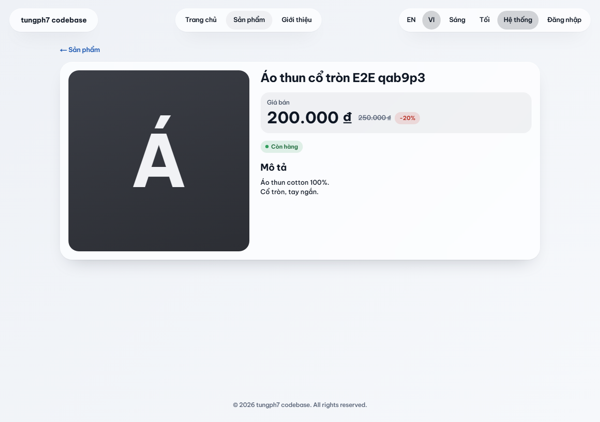
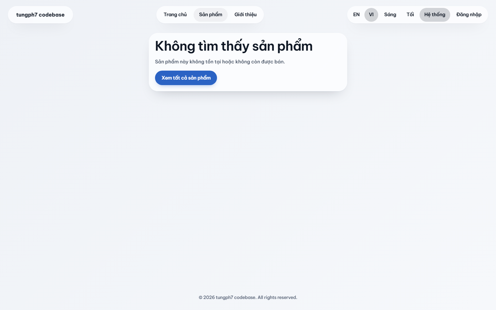
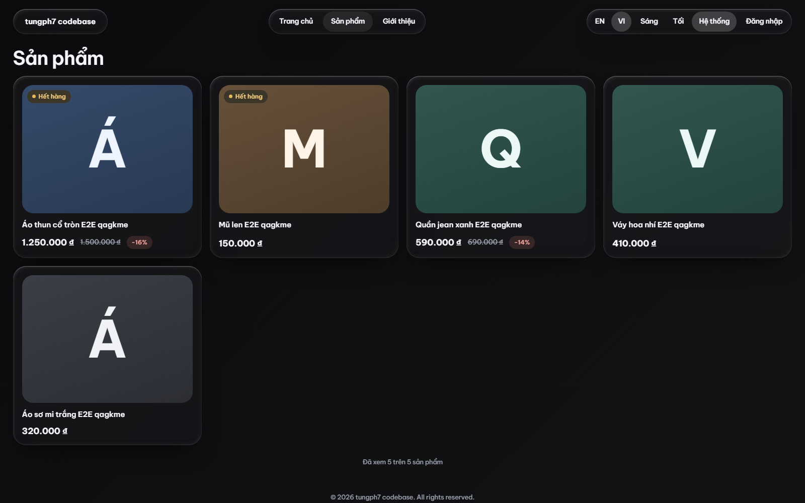

# Hướng dẫn cho khách

Trang của cửa hàng: https://shop.ao.t2g.io.vn. Mở trang, nhập tên và mật khẩu khi trình duyệt hỏi ([README](README.md)), rồi bấm **Sản phẩm** trên thanh trên cùng. Đường dẫn của trang này là `/vi/products` (tiếng Việt) hay `/en/products` (tiếng Anh).

## 1. Xem danh sách sản phẩm

- **Trang chỉ có sản phẩm đang bán,** sản phẩm mới nhất ở trước.
- **Mỗi thẻ sản phẩm có:**
  - ô màu với chữ cái đầu của tên;
  - tên;
  - giá bán.

  Sản phẩm giảm giá có thêm giá gốc gạch ngang và phần trăm giảm, như "-16%". Sản phẩm hết hàng có nhãn **Hết hàng**, và vẫn ở trong danh sách.
- **Bấm vào thẻ** để mở trang chi tiết của sản phẩm (mục 5).
- **Mỗi lần trang hiện 24 sản phẩm.** Dưới cùng có dòng như "Đã xem 24 trên 30 sản phẩm" và nút **Xem thêm**. Bấm **Xem thêm** thì các sản phẩm tiếp theo hiện nối bên dưới. Khi đã xem hết, nút biến mất.

## 2. Tìm sản phẩm

1. Gõ tên vào ô **Tìm sản phẩm…**.
2. Bấm **Enter**.

- **Không cần gõ dấu, không phân biệt chữ hoa hay chữ thường:** `ao thun`, `ÁO THUN` và `Áo Thun` cho cùng kết quả. `d` cũng khớp `đ`.
- **Mỗi từ bạn gõ khớp với phần đầu của một từ trong tên,** theo thứ tự bất kỳ. Ví dụ: `ao` ra "Áo thun cổ tròn", nhưng không ra "Bao tay len".
- **Khi đang tìm, sản phẩm được xếp theo Liên quan nhất.** Thứ tự gồm ba nhóm:
  1. tên bắt đầu bằng đúng cụm bạn gõ;
  2. tên có cụm đó ở giữa, bắt đầu từ đầu một từ;
  3. tên có đủ các từ, nhưng không liền nhau.
- **Từ khóa tối đa 100 ký tự;** phần dài hơn bị bỏ.
- **Muốn bỏ tìm kiếm:** xóa chữ trong ô rồi bấm **Enter**.

## 3. Sắp xếp

Chọn trong ô **Sắp xếp**, bên phải ô tìm:

| Lựa chọn | Thứ tự |
|---|---|
| Mới nhất | Sản phẩm mới thêm đứng trước (mặc định khi không tìm) |
| Giá thấp đến cao | Giá bán tăng dần |
| Giá cao đến thấp | Giá bán giảm dần |
| Liên quan nhất | Chỉ có khi đang tìm, và là mặc định lúc đó |

Hai sản phẩm bằng giá thì sản phẩm mới hơn đứng trước.

## 4. Chia sẻ đường dẫn

Đường dẫn trên thanh địa chỉ giữ ba thứ: từ khóa, kiểu sắp xếp, và số sản phẩm bạn đã xem qua **Xem thêm**. Vì vậy:
- tải lại trang thì vẫn thấy đúng những gì đang xem;
- chép đường dẫn gửi cho người khác thì họ thấy cùng danh sách.

Nếu đường dẫn bị sửa thành giá trị sai, trang dùng cách xem mặc định thay vì báo lỗi.

## 5. Trang chi tiết sản phẩm

- **Trang có:**
  - tên và giá bán;
  - giá gốc gạch ngang và phần trăm giảm, nếu sản phẩm đang giảm giá;
  - nhãn **Còn hàng** hay **Hết hàng**;
  - **Mô tả**, giữ nguyên các dòng như người bán đã nhập.
- **Bấm "← Sản phẩm"** để về danh sách.
- **Đường dẫn của trang** có dạng `/vi/products/ao-thun-co-tron`. Bạn chép nó để gửi cho người khác.

## 6. Trang "Không tìm thấy sản phẩm"

Bạn gặp trang này khi:
- sản phẩm không tồn tại;
- sản phẩm đã ngừng bán hay đã bị xóa;
- đường dẫn cũ của sản phẩm đã được đổi.

Bấm **Xem tất cả sản phẩm** để về danh sách.

## 7. Ngôn ngữ và giao diện

- **Ngôn ngữ:** bấm **EN** hay **VI** ở góc phải. Đường dẫn đổi giữa `/en/…` và `/vi/…`. Giá vẫn viết kiểu `1.250.000 ₫`.
- **Giao diện:** bấm **Sáng**, **Tối** hay **Hệ thống**. **Hệ thống** theo cài đặt sáng hay tối của máy bạn.
- **Trên điện thoại, và trên màn hình hẹp hơn 1024 px:**
  - ba nút giao diện chỉ còn biểu tượng: mặt trời là **Sáng**, mặt trăng là **Tối**, màn hình là **Hệ thống**;
  - **EN** và **VI** vẫn là chữ.

## 8. Khi gặp lỗi

| Bạn thấy | Nghĩa là | Làm gì |
|---|---|---|
| "Không tìm thấy sản phẩm nào cho “…”" | Không sản phẩm đang bán nào khớp từ khóa | Kiểm tra chính tả, hay gõ ít từ hơn. Bấm **Xóa tìm kiếm** để xem lại cả danh sách |
| "Chưa có sản phẩm nào." | Cửa hàng chưa có sản phẩm đang bán | Quay lại sau |
| "Không tải thêm được. Vui lòng thử lại." ngay trên nút **Xem thêm** | Cửa hàng chưa đọc được các sản phẩm tiếp theo. Các sản phẩm đã hiện vẫn còn | Bấm **Xem thêm** lần nữa. Vẫn lỗi thì tải lại trang sau vài phút |
| Trang báo không có kết nối Internet của trình duyệt, sau khi bấm **Xem thêm** hay một liên kết | Máy bạn đang mất mạng. Các sản phẩm đã hiện tạm biến mất | Khi có mạng lại, tải lại trang (phím F5). Đường dẫn giữ từ khóa, kiểu sắp xếp và các sản phẩm bạn đã xem |
| Trang "Không tìm thấy sản phẩm" | Xem mục 6 | Bấm **Xem tất cả sản phẩm** |
| "Tạm thời không tải được sản phẩm" | Cửa hàng đang gặp sự cố | Tải lại trang sau vài phút |
| "Đã xảy ra lỗi" và nút **Thử lại** | Trang gặp lỗi khi tải | Bấm **Thử lại**. Vẫn lỗi thì chờ vài phút rồi tải lại |
| Giá hay tình trạng khác với điều cửa hàng vừa báo | Thay đổi của cửa hàng hiện trên trang trong vòng 60 giây | Chờ một phút, rồi tải lại trang |
| Trình duyệt hỏi tên và mật khẩu | Cửa hàng chưa mở cho mọi người | Xem [README](README.md) |
