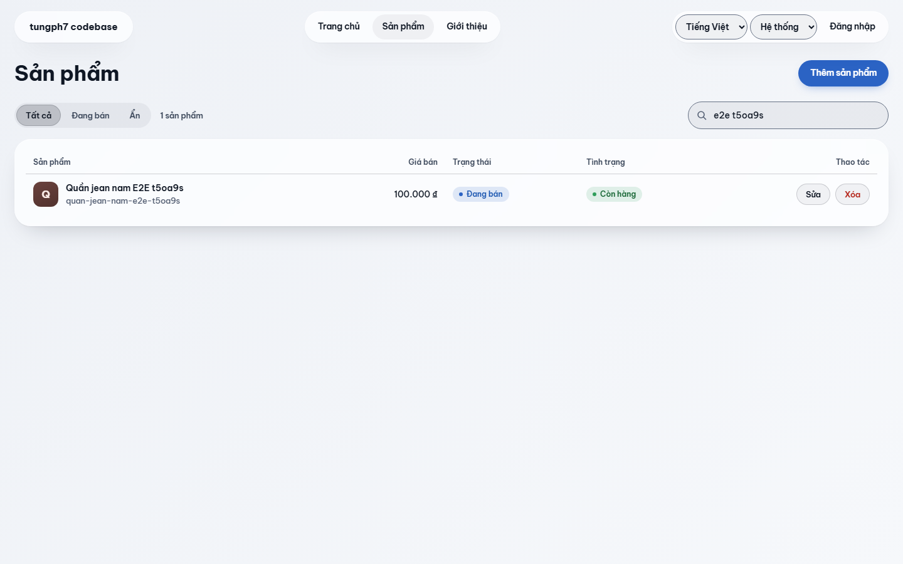
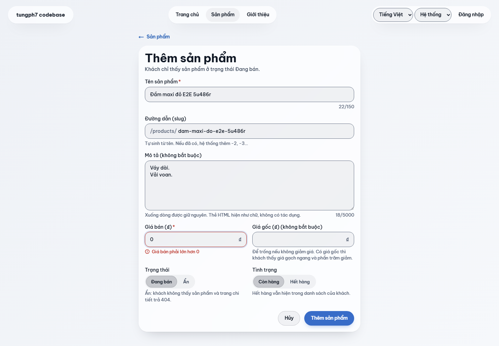
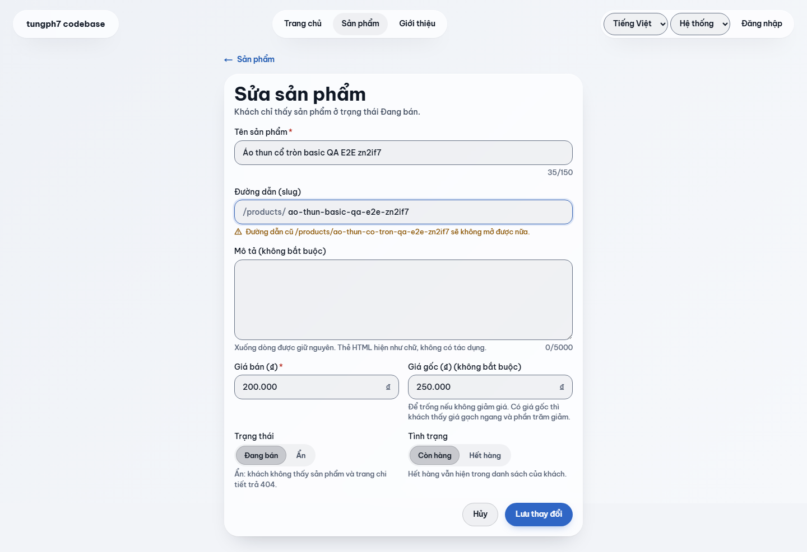
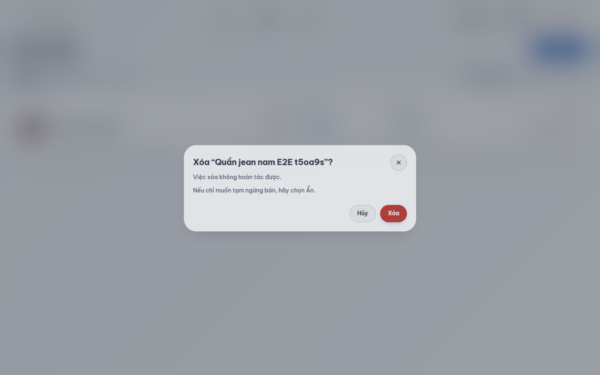
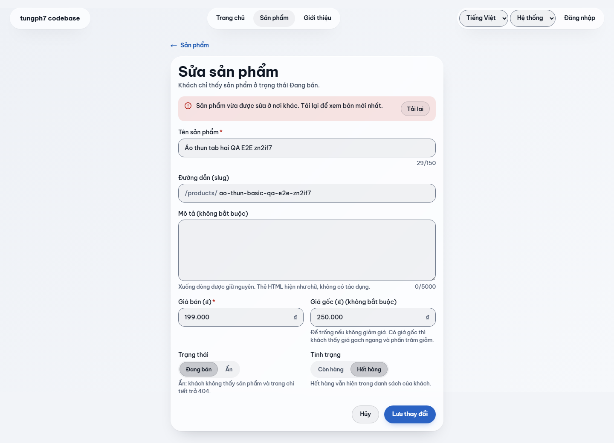
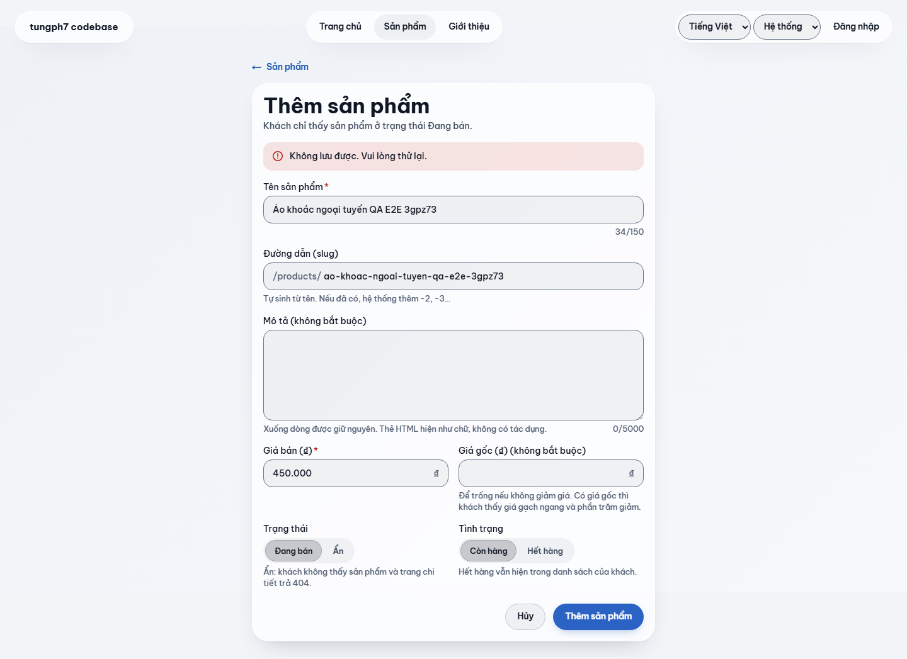

# Hướng dẫn cho quản trị viên

Trang quản trị: https://shop-admin.ao.t2g.io.vn. Mở trang, nhập tên và mật khẩu khi trình duyệt hỏi ([README](README.md)), rồi bấm **Sản phẩm** trên thanh trên cùng.

## 1. Xem, tìm và lọc danh sách

- **Danh sách gồm mọi sản phẩm**, cả Đang bán lẫn Ẩn, sản phẩm mới nhất ở trên.
- **Mỗi dòng có:**
  - ô màu với chữ cái đầu của tên;
  - tên và đường dẫn (slug);
  - giá bán;
  - trạng thái (**Đang bán** hay **Ẩn**);
  - tình trạng (**Còn hàng** hay **Hết hàng**);
  - hai nút **Sửa** và **Xóa**.
- **Mỗi trang 20 sản phẩm.** Dưới bảng có dòng "Hiển thị 1–20 trên 25", các nút **Trước**, **Sau** và số trang.
- **Tìm theo tên:** gõ vào ô **Tìm theo tên sản phẩm…**.
  - Không cần dấu, không phân biệt chữ hoa hay chữ thường. `đ` cũng khớp `d`.
  - Mỗi từ bạn gõ khớp với phần đầu của một từ trong tên, theo thứ tự bất kỳ. Ví dụ: `ao th` ra "Áo thun cổ tròn", nhưng `ao` không ra "Bao tay len".
- **Lọc theo trạng thái:** bấm **Tất cả**, **Đang bán** hay **Ẩn**. Bên cạnh là số sản phẩm khớp.
- **Không có sản phẩm nào khớp:** trang báo "Không có sản phẩm nào khớp". Bấm **Xóa bộ lọc** để xem lại cả danh sách.
- **Đường dẫn trên thanh địa chỉ giữ từ khóa, bộ lọc và số trang.** Tải lại trang, hay gửi đường dẫn cho đồng nghiệp, thì vẫn thấy đúng như bạn đang thấy.

## 2. Thêm sản phẩm

1. Bấm **Thêm sản phẩm** ở góc phải, trên danh sách.
2. Điền form:

   | Ô | Bắt buộc | Quy tắc |
   |---|---|---|
   | Tên sản phẩm | Có | 1–150 ký tự. Khoảng trắng ở đầu và cuối bị bỏ |
   | Đường dẫn (slug) | Tự điền | Lúc bạn gõ tên, ô này tự điền: "Đầm maxi đỏ" thành `dam-maxi-do`. Nếu slug đó đã có, hệ thống thêm `-2`, `-3`…. Muốn sửa tay thì chỉ dùng chữ thường a–z, số và dấu gạch ngang; không bắt đầu hay kết thúc bằng gạch ngang; tối đa 100 ký tự |
   | Mô tả | Không | Tối đa 5.000 ký tự. Xuống dòng được giữ nguyên. Thẻ HTML như `<b>` hiện ra như chữ, không có tác dụng |
   | Giá bán (₫) | Có | Số nguyên đồng, từ 1 tới 999.999.999. Dấu chấm là dấu ngăn hàng nghìn: gõ `250.000` hay `250000` đều là 250.000 ₫. Không có phần lẻ |
   | Giá gốc (₫) | Không | Để trống nếu không giảm giá. Nếu có thì phải lớn hơn giá bán. Khách sẽ thấy giá gốc gạch ngang và phần trăm giảm, làm tròn xuống: 250.000 ₫ còn 200.000 ₫ là `-20%` |
   | Trạng thái | | **Đang bán** (mặc định) hay **Ẩn** |
   | Tình trạng | | **Còn hàng** (mặc định) hay **Hết hàng** |

3. Bấm **Thêm sản phẩm** ở cuối form. Trang báo "Đã thêm sản phẩm", và sản phẩm mới đứng đầu danh sách.

Muốn bỏ, bấm **Hủy** hay **← Sản phẩm**.

## 3. Sửa sản phẩm

1. Bấm **Sửa** ở dòng của sản phẩm.
2. Đổi những ô cần đổi, rồi bấm **Lưu thay đổi**. Trang báo "Đã lưu sản phẩm".

- **Đổi tên không đổi slug,** nên đường dẫn của khách giữ nguyên.
- **Đổi slug thì đường dẫn cũ hỏng.** Form cảnh báo ngay, ví dụ "Đường dẫn cũ /products/ao-thun-co-tron sẽ không mở được nữa.". Sau khi lưu, ai mở đường dẫn cũ (đã lưu hay đã được chia sẻ) đều gặp trang "Không tìm thấy sản phẩm". Chỉ đổi slug khi thật cần.

## 4. Ẩn sản phẩm, hay đánh dấu hết hàng

| Bạn muốn | Chọn trong form Sửa | Khách thấy |
|---|---|---|
| Tạm ngừng bán | Trạng thái **Ẩn** | Sản phẩm không còn trong danh sách. Trang chi tiết là "Không tìm thấy sản phẩm". Sản phẩm cũng ra khỏi sitemap, tức danh sách trang gửi cho Google. Chọn lại **Đang bán** thì sản phẩm hiện lại, ở đúng đường dẫn cũ |
| Báo hết hàng nhưng khách vẫn xem được | Tình trạng **Hết hàng** | Sản phẩm vẫn trong danh sách, có nhãn "Hết hàng" |

Sản phẩm Ẩn vẫn nằm trong danh sách của trang quản trị, với nhãn **Ẩn**.

## 5. Xóa sản phẩm

1. Bấm **Xóa** ở dòng của sản phẩm.
2. Một hộp thoại hỏi "Xóa “‹tên›”?". Hộp nhắc "Việc xóa không hoàn tác được." và "Nếu chỉ muốn tạm ngừng bán, hãy chọn Ẩn."
3. Bấm **Xóa** trong hộp thoại để xóa, hay **Hủy** để giữ lại.

Xóa xong:
- Trang báo "Đã xóa sản phẩm".
- Trang của sản phẩm phía khách thành "Không tìm thấy sản phẩm".
- Slug của nó dùng lại được cho sản phẩm mới.

**Sản phẩm đã xóa không lấy lại được.** Nếu chỉ muốn tạm ngừng bán, hãy dùng **Ẩn** (mục 4).

## 6. Khi nào khách thấy thay đổi

Mọi thay đổi bạn lưu hiện ở trang của khách **trong vòng 60 giây**: danh sách, trang chi tiết và sitemap. Khách đang mở trang thì tải lại trang mới thấy.

## 7. Khi gặp lỗi

**Lỗi khi nhập.** Ô sai có chữ đỏ ngay bên dưới. Lúc đó chưa có gì được lưu, và những gì bạn đã nhập vẫn còn nguyên. Sửa đúng ô đó rồi bấm lưu lại.

| Chữ đỏ | Khi nào |
|---|---|
| Nhập tên sản phẩm | Tên trống |
| Tên tối đa 150 ký tự | Tên dài hơn 150 ký tự |
| Chỉ dùng chữ thường a–z, số và dấu gạch ngang; không bắt đầu hay kết thúc bằng dấu gạch ngang. | Slug có chữ hoa, dấu, khoảng trắng hay ký tự khác |
| Slug tối đa 100 ký tự | Slug dài hơn 100 ký tự |
| Slug này đã được dùng | Slug bạn tự gõ trùng với một sản phẩm khác. Đổi slug khác |
| Các slug tự sinh từ tên này đều đã được dùng. Hãy tự nhập một slug. | Quá nhiều sản phẩm cùng tên. Tự gõ một slug |
| Mô tả tối đa 5.000 ký tự | Mô tả quá dài |
| Giá bán phải lớn hơn 0 | Giá bán trống, bằng 0, hay không phải số |
| Giá phải là số nguyên đồng | Giá có phần lẻ, như `250000,5` |
| Giá tối đa 999.999.999 ₫ | Giá quá lớn |
| Nhập giá bằng số, như 250.000 | Giá gốc không phải số |
| Giá gốc phải lớn hơn giá bán | Giá gốc bằng hay nhỏ hơn giá bán |

**Thông báo ở đầu form, hay ở đầu trang:**

| Bạn thấy | Nghĩa là | Làm gì |
|---|---|---|
| "Sản phẩm vừa được sửa ở nơi khác. Tải lại để xem bản mới nhất." và nút **Tải lại** | Sau lúc bạn mở form, một người khác (hay một tab khác của chính bạn) đã lưu sản phẩm này. Bản của bạn **chưa được lưu**, để không ghi đè lên thay đổi của họ | Nếu cần, chép lại những gì bạn vừa sửa. Bấm **Tải lại** để mở bản mới nhất, rồi sửa lại |
| "Không lưu được. Vui lòng thử lại." | Mất mạng, hay máy chủ đang lỗi. Chưa có gì được lưu, và những gì bạn đã nhập vẫn còn. Trang **không tự gửi lại** khi có mạng trở lại | Kiểm tra mạng, rồi bấm nút lưu lần nữa. Vẫn lỗi sau vài phút thì báo người quản trị hệ thống |
| "Không xóa được. Vui lòng thử lại." trong hộp thoại xóa | Mất mạng hay máy chủ lỗi; sản phẩm **chưa** bị xóa | Bấm **Xóa** lần nữa khi đã có mạng |
| "Không tải được danh sách sản phẩm." và nút **Thử lại** | Không đọc được danh sách | Bấm **Thử lại**; kiểm tra mạng |
| "Không tải được sản phẩm." và nút **Thử lại** | Không mở được form sửa | Bấm **Thử lại** |
| "Không tìm thấy sản phẩm này. Có thể nó đã bị xóa." | Bạn mở form sửa của một sản phẩm đã bị xóa | Bấm **Về danh sách sản phẩm** |
| Trình duyệt hỏi tên và mật khẩu lần nữa | Tên hay mật khẩu sai | Nhập lại; quên thì hỏi người quản trị hệ thống |
| Khách chưa thấy thay đổi | Chưa đủ 60 giây | Chờ một phút, rồi tải lại trang của khách |

